# HVIDEO Debug Page User Manual

Illustrated Edition  Revision 2  14 November 2026

For deployment, commissioning, show operation, and maintenance teams. This manual covers the desktop debug interface, Fusion Mobile, and separate maintenance entry points. Use the feature chapters for individual tasks or Chapter 13 for commissioning workflows.

## Using This Manual

Confirm the target before editing, save at the correct level, then refresh to read back the device. Layer dragging, media previews, Cue previews, and peripheral sends can affect live output immediately. Unlicensed modules may be hidden; the current device determines available fields and choices.

Numbered markers connect figures to the text. DEMO devices, addresses, materials, and values illustrate the interface; replace them with site values. Figures show the current interface, with selected existing device captures for detail. Diagrams explain workflow relationships.

## Contents

1. Access Login and Preparation

2. System Status and Command Log

3. Layer Matrix and Properties

4. Materials Playlists and Playback

5. Scene Templates and Default Configuration

6. Effects and Audio Reactive Engine

7. Projection Blending and Mobile Control

8. CAVE and Matrix Correction

9. Stage Control and Cue Timeline

10. Peripheral Configuration and Communication

11. System Settings and Maintenance

12. Troubleshooting

13. Commissioning Workflows

14. Parameters and Keyboard Reference

15. Feature Coverage and Handover

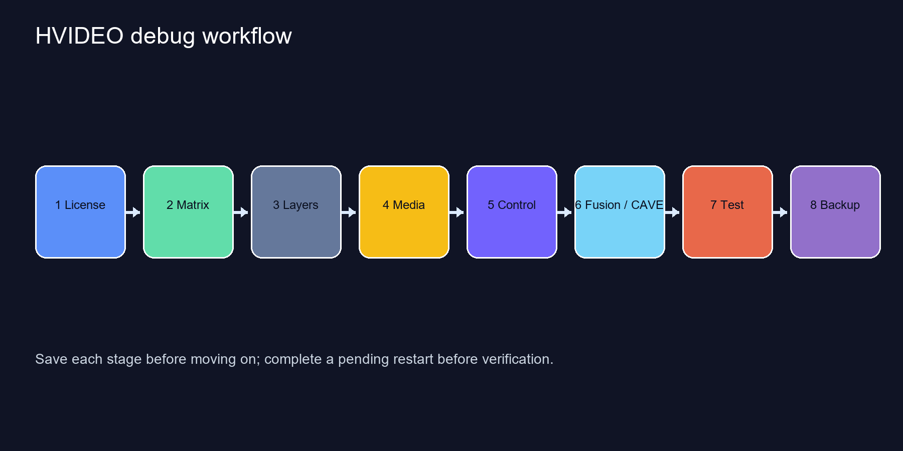

Figure 1 Commissioning sequence

## Chapter 1 Access Login and Preparation

### 1.1 Connect and Sign In

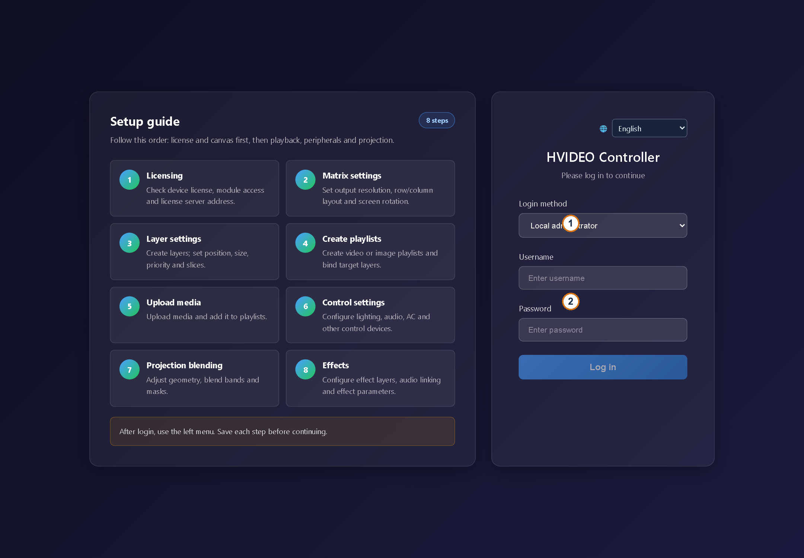

Figure 2 Login Method and Credentials

1. Connect the computer or tablet to the player control network.
2. Open `http://PLAYER-IP:8080/` in a browser.
3. Select Local Administrator or Cloud Agent and sign in with the corresponding credentials.
4. Confirm the device name and IP after login; sign in again if the session expires.
5. Use the language selector to change the interface language. Obtain credentials from the device administrator.


1 Login method; 2 credential area.

### 1.2 Navigation and License Availability

The navigation lists System Status, Layer Matrix, Video Control, Scene Templates, Effects, Projection Blending, CAVE, Stage Control, Control Settings, and System Settings. The menu can collapse. Scene, effects, blending, CAVE, stage, and VOD configuration depend on module licenses; the layer pool is licensed too. Check System Settings when an entry is missing.

### 1.3 Restart and Operation Interruptions

Restart App restarts the player application; Reboot System restarts the device. Save changes first and confirm that playback may be interrupted. Some actions request confirmation. After a network interruption, read back actual state before repeating a restart, deletion, or restore.

## Chapter 2 System Status and Command Log

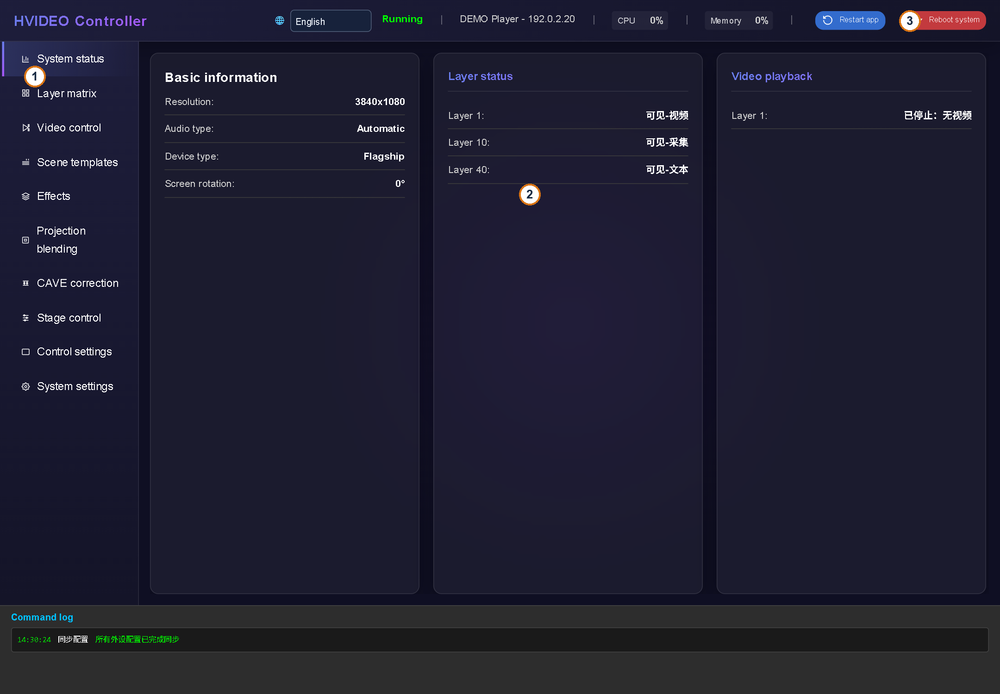

Figure 3 System Status Areas

1 Navigation; 2 device, layer, and playback status; 3 header resources and restart controls.

### 2.1 Read Status

Shows resolution, audio type, device type, screen rotation, layer status, and video playback status. The header continues to show system state and resource use. This page is primarily for monitoring and has no configuration save action.

### 2.2 Command Log and Result Verification

The command log records operation time, action, and success or failure. Check the result message, inspect the actual output, then refresh the relevant page. System Status is observational and needs no save. CPU and memory values indicate trends; also inspect the output. A browser timeout does not prove that the device did not execute an action.

## Chapter 3 Layer Matrix and Properties

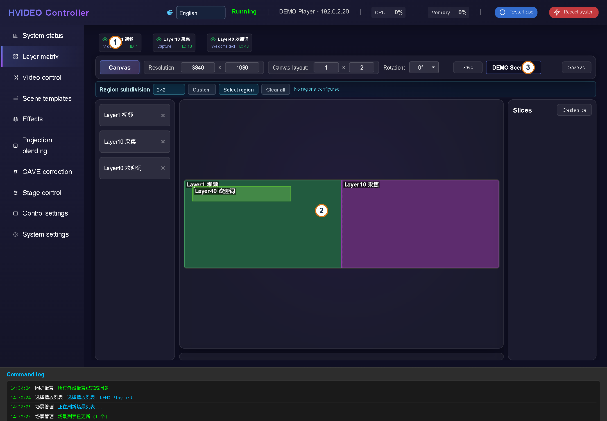

Figure 4 Canvas Layers and Slices

1 Authorized layer entries; 2 canvas and layers; 3 Save and Save As. Properties below change with the selected layer.

### 3.1 Canvas and Read Only Layout Values

The canvas shows the display layout, layers, and slices. Canvas width/height, rows/columns, and rotation at the top are read-only.

### 3.2 Select Drag and Fine Tune

Select a layer or slice to inspect its properties. Drag a layer to move it; drag its edge/control points to resize or edit its region. Dragging affects the running picture. Numeric fields provide precise position, size, priority, opacity, and rotation values.

### 3.3 Multi Select Snap and Context Menu

Layers support Ctrl/Shift/Command multi-selection and snap guides while dragging. Right-click a layer for quick alignment and canvas-fraction sizing. Use a field's reset control to restore that field's default.


Quick alignment includes left, right, horizontal center, top, and bottom. Fraction sizing sets width or height to 1/2, 1/3, 1/4, 2/3, 2/4, or 3/4 of the canvas. It changes only that dimension and clamps position inside the canvas when necessary.

### 3.4 Remove a Scene Layer

The delete control in the layer list removes the layer from the current scene and hides its runtime layer. Only authorized, available layer types can be created or edited.

### 3.5 Save Default or Named Scene

**Save** stores the default configuration; the dropdown selects a scene configuration; **Save As** stores the current configuration under a name. Confirm the selected scene before saving.

### 3.6 Region Guide Splitting

Region subdivision offers 2×2, 3×3, 4×4, and custom row/column counts. Choose **Select Area**, then click a canvas region to apply helper guides. **Clear All** clears the guides.

### 3.7 Layer Cards and Property Tabs

Drag the layer-card strip horizontally to browse it. Selecting an existing layer exposes **Common/Advanced** property tabs. Use canvas dragging or Common fields for exact position and size.

### 3.8 Create Edit and Delete Slices

**Create Slice** adds an independently configurable sub-region to the selected layer. Slices have Common/Advanced properties, show/hide, save, and delete actions. Verify the target before deleting.

### 3.9 Common Properties and Ranges

Common fields include X/Y, width/height, priority, opacity, rotation, volume, and applicable text/font fields. Priority is 0–100, opacity 0–255, rotation 0–360 degrees, and edge crop 0–100%. Confirm units before using increment/decrement controls; reset acts on the associated field.


Top, bottom, left, and right crop values adjust material boundaries in percent (0-100). Common opacity uses 0-255, priority 0-100, and rotation 0-360 degrees; slices can have independent visibility and crop. Available shapes appear in the shape selector. If a shape parameter appears after selection, configure it as well.

### 3.10 Video Layers

Video: volume, Gaussian blur, fill/aspect-preserving fit, four-edge crop, shape and shape parameter, image inversion, black-to-transparent, roam direction/speed/range/loop, and rotation.

### 3.11 Image Layers

Image: static/dynamic display, linear/nearest-neighbor filtering, fade-in/fade-out/display duration, plus common shape, crop, and position properties.

### 3.12 Text Lyrics and Messages

Text/lyrics/messages: text, font, text/background colors or transparent background, centered/scrolling display, position, alignment, list visibility, playlist binding, font size, item count, duration, and hint start/end time. Fields depend on the layer type.

### 3.13 QR Code Layers

QR code: QR content, footer text, border color, position, size, priority, and the Fusion Debug switch. The Fusion Debug QR code is also controlled by **System Settings > Common Config > Startup IP Hint**.

### 3.14 Capture Input and EDID

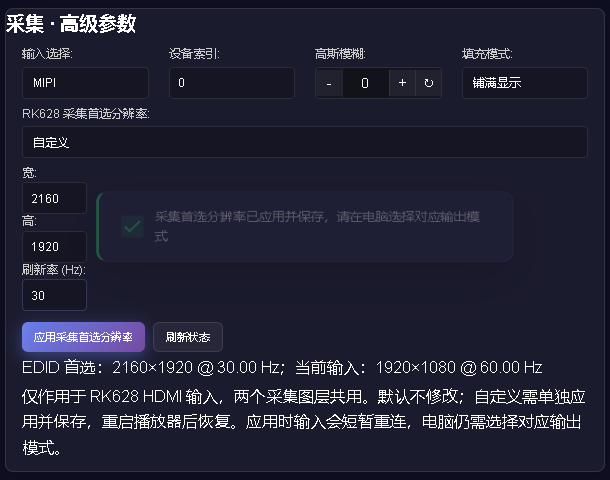

Figure 5 Capture Input and EDID Detail in Chinese UI

Capture layers: choose Auto, HDMI, USB, or MIPI input; device index; Gaussian blur; and fit mode. Advanced EDID controls read status and apply the default or a custom preferred resolution. Custom width must be 320–4088 and divisible by 8; height 240–2160; refresh rate an integer from 24–60 Hz. After applying a custom EDID, select the matching output mode on the source computer.

### 3.15 Wireless and USB Mirroring

Mirroring layers: start or refresh Apple, Android/Windows, and USB mirroring. Apple mirroring also supports PIN reset. Configure the ready hint, which service starts with the app, the scene selected for detected TV mirroring, and vertical crop pixels. Options depend on device support.

### 3.16 Effect Layers

Effect layers: enter an effect ID and JSON parameters. Validate the JSON and target layer before applying.


### 3.17 Verify a Layout Change

Select a visible video layer, enter the required X/Y, and inspect the output. Create a slice and verify visibility for both the parent and slice. Save the scene, leave it, then reload to confirm position, size, and slices. After changing capture EDID, select the matching source-computer mode and verify the incoming signal.

## Chapter 4 Materials Playlists and Playback

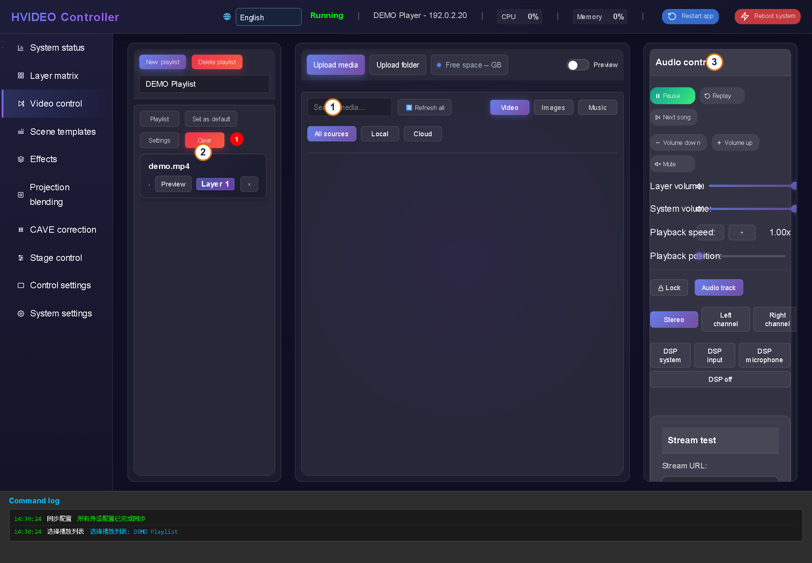

Figure 6 Materials Playlists and Playback Controls

1 Material type and source; 2 playlist workspace; 3 audio and playback controls.

### 4.1 Material Types Sources and Upload

Filter materials by video, image, or music and by local/cloud source. Search, browse folders, refresh, or drag files/folders into the upload area. Upload progress and, when available, remaining internal/SATA storage are shown.

### 4.2 Manage Materials and Folders

A material can be previewed as video, viewed as an image, or played as audio. Material actions include add to playlist, download, rename, and delete. Folders can be renamed or deleted. Deleting a folder deletes all its files and cannot be undone; default folders are protected.

### 4.3 Reencode and Batch Optimize

Select videos to **Re-encode** or **Batch Optimize**. Already optimized files are skipped. Monitor progress and avoid launching the same job twice.

### 4.4 Create and Manage Playlists

Playlist controls include create, select, play, delete playlist, clear contents, set default, and settings. Creation sets a name, target layer, loop mode, and, where supported, DMX ID. The target layer must be licensed for playback.

### 4.5 Playlist Selection and Playback Behavior

In the current implementation, changing the playlist selector automatically starts that playlist. Selecting an item is for viewing/editing contents. **Play** starts the selected playlist again. Confirm the target before deleting a playlist or clearing its contents.

### 4.6 Loop Modes and Image Timing

Playlist settings include loop mode and DMX ID. Image playlists also have display duration, fade-in, and fade-out. Available modes include Repeat All, Play Once, Repeat One, Sequential Loop, and Fixed Playback; options vary by layer type.

### 4.7 Seek Speed Volume and Playback

Audio controls provide pause/resume, replay, next track, volume down/up, and mute. Adjust layer and system volume separately. Use minus/plus to change playback speed and drag the progress slider to seek.

### 4.8 Playback Lock

**Lock** toggles the selected layer's playback lock. If a global lock is active, the page indicates that this button controls only the layer lock.

### 4.9 Preview Switch and Floating Window

If video preview is enabled, a playlist item's **Preview** action also opens a draggable MJPEG window. Close it from the title bar; turning preview off also closes it. Preview playback operates on the target layer.

### 4.10 Audio Tracks Channels and DSP Routes

The audio-track button switches available tracks. Choose stereo, left, or right channel. DSP route buttons test DSP System, DSP Input, DSP Mic, or Off; these are immediate hardware actions.

### 4.11 Stream Playback Test

Stream Test: enter a URL reachable by the device and click **Test Playback**. The displayed sample URL is a placeholder and does not imply that the media exists on the device.

### 4.12 Storage and Playlist Items

- Video materials can use internal storage or a SATA disk. Resolve insufficient space or an unwritable disk first; images and music use internal storage. Cloud categories filter cloud materials and are not local upload destinations. Upload Materials selects multiple files; Upload Folder uploads a directory. Drag and drop is also supported. Verify the local/cloud source and current directory first; refresh after completion and add the files to the playlist for the intended layer.
- Playlist content supports item selection, preview, and removal. Removing a playlist item differs from deleting its material file. Clear only clears the current playlist's contents; verify the name before deleting a playlist.

### 4.13 From Upload to Default Playback

1. Select Video and Local, then confirm the directory and free space.
2. Upload a supported video, refresh, and preview the file.
3. Create a playlist with a licensed video layer and loop mode.
4. Add the material, play it, and verify progress, audio, and picture.
5. Set a DMX ID if needed, then make the playlist default.
6. Reload and verify contents and default selection. When startup playback must be verified, restart during an approved interruption.

## Chapter 5 Scene Templates and Default Configuration

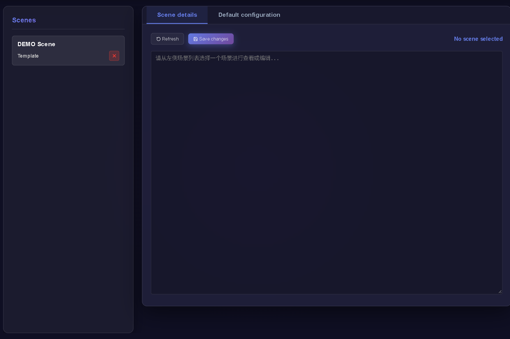

Figure 7 Scene List and JSON Editor

### 5.1 Edit and Save Scene JSON

Select a scene on the left. **Refresh** rereads the selected scene; **Save Changes** writes the JSON editor content back to it. Consider copying the original before editing and validate JSON before saving.

### 5.2 Default Configuration and Restart Boundary

The **Default Config** tab loads and submits the core `config.json`. It affects system behavior. Change only understood keys and restart the app as directed after saving.

### 5.3 Delete Scenes and Check Before Saving

Use a scene row delete button to remove that scene; the default configuration is protected. Keep the original JSON, verify the scene name and syntax, save, then reselect the scene to confirm the content. Save As in Layer Matrix creates a layout scene; this page inspects and edits existing content.

## Chapter 6 Effects and Audio Reactive Engine

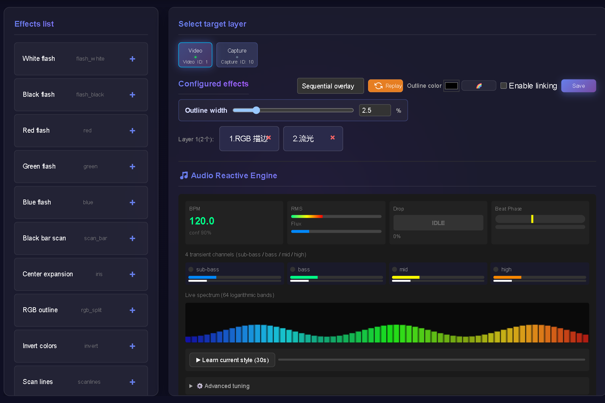

Figure 8 Target Layers Effect Stack and Audio Analysis

### 6.1 Configure Preview Link and Save

Select a target layer and configure one or more live effects. Preview an individual effect, choose sequential or parallel stacking, set outline color and width, enable linked playback, and save. Whether settings are applied to each layer immediately depends on the linked-playback state.

### 6.2 Beat Learning and Advanced Tuning

The Audio Reactive Engine displays beat/BPM and confidence. **Learn Current Style (30s)** analyzes the current playback; activating it again can stop learning. **Advanced Tuning** exposes frequency bands, transient thresholds, BPM range, Drop detection/decay, spectrum gain, and dense-beat detection. Changes are submitted to the device; adjust a few values at a time and observe the result.

### 6.3 Color Outline and Remove Effects

Select the target layer before adding effects. Color and outline width act on the selected object. The rainbow button restores rainbow mode, Replay tests playback, and the remove control drops an assigned effect. Review and save linkage, stacking mode, and the effect list together. Chapter 14 lists every current effect ID.

### 6.4 All Audio Reactive Tuning Controls

Live indicators include BPM and confidence, RMS, Flux, Drop state and intensity, Beat Phase, four-band energy/transients, and a 64-band spectrum. Play representative audio before evaluating these values. Expand Advanced Tuning; dragging shows the value, and releasing the slider submits its change to the device. These controls do not depend on the effect Save button. Change one group of parameters at a time and observe the result.

| On Screen Parameter | Range and Step | Use |
|---|---|---|
| cut sub/bass Hz | 20–200, step 5 | Sub-bass/bass boundary |
| cut bass/mid Hz | 100–800, step 10 | Bass/mid boundary |
| cut mid/high Hz | 800–6000, step 50 | Mid/high boundary |
| Threshold sub, bass, mid, high | Each 1.1–3.0, step 0.05 | Separate transient threshold for each band |
| BPM minimum and maximum | Minimum 40–120; maximum 120–240; step 1 | Beat search range |
| Drop RMS ratio | 1.2–4.0, step 0.05 | Drop detection parameter |
| Drop decay | 0.2–5.0 seconds, step 0.1 | Drop intensity decay time |
| Spectrum gain | 0.5–3.0, step 0.1 | Spectrum gain parameter |
| Dense mid multiplier | 1.02–2.0, step 0.02 | Dense beat ratio parameter |
| Dense high multiplier | 1.00–1.6, step 0.02 | Dense beat ratio parameter |
| Dense entry ratio label | 100–800, step 20 | Entry confirmation time in ms |
| Dense exit ratio label | 20–500, step 20 | Exit confirmation time in ms |

### 6.5 Verify the Effect Configuration

Select a target video layer, add and preview an effect, choose stacking and linkage, then save. Select another layer and return to verify the stack. Play actual show material and observe BPM, transients, and effect response. Remove test effects and save the final combination.

## Chapter 7 Projection Blending and Mobile Control

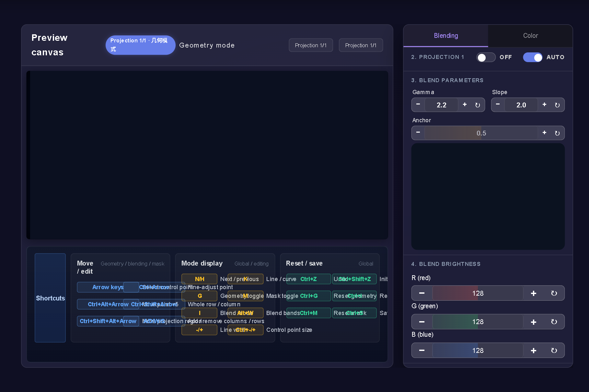

Figure 9 Desktop Blending Canvas and Controls

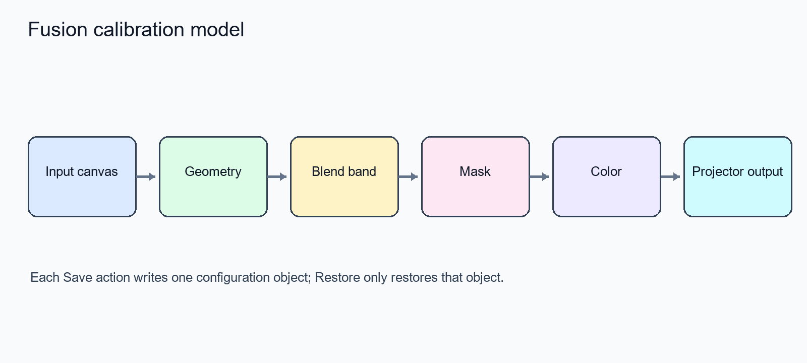

Figure 10 Geometry Blend Mask and Color Relationship

### 7.1 Layout and Region Selection

The preview canvas shows input grids, blend regions, and control points. **Layout Presets** choose a fusion layout; **Projector N/M** switches between projector regions.

### 7.2 Blend Edges and Auto Adjacency

**Fusion** and **Color** tabs edit geometry/blend/mask and region color. The blend area has a master switch, automatic neighboring-edge selection, and manual top/bottom/left/right edge switches.

### 7.3 Blend Curves and Region Color

Gamma, Slope, Anchor, and RGB blend-band brightness adjust the blend curve. The Color tab adjusts brightness, contrast, and saturation.

### 7.4 Geometry Grid and Mask Interpolation

Geometry supports selecting/dragging points, canvas grids, and grid row/column changes. Blend/mask interpolation can use straight or curved lines. The mask controls input-canvas crop/bounds.

### 7.5 Debug Background and Performance

When loaded, background controls select previous/next, show/hide the fusion debug background, and **Performance** pauses playing video layers during debugging.

### 7.6 Open Fusion Mobile

If available, open the Fusion Mobile QR/link in a phone browser on the same network at `/fusion-mobile/`. The mobile page includes Layout, Geometry, Blend, Mask, Color, Advanced Correction, plus quick panels for Layer Matrix, Video Control, Peripheral Configuration, and System Status. Its **Save Geometry/Blend/Mask/Color** actions submit the corresponding configuration.

### 7.7 Save Undo Restore and Initialize

Calibration edits can affect output immediately. Use Save or Ctrl+S to persist the blending configuration. Ctrl+Z undoes the latest edit; Ctrl+G/I/M restore geometry, blend, and mask; Ctrl+Shift+Z initializes the related calibration. Confirm the region before restore or initialization. See Chapter 14 for all shortcuts.


### 7.8 Fusion Mobile Panel Operations

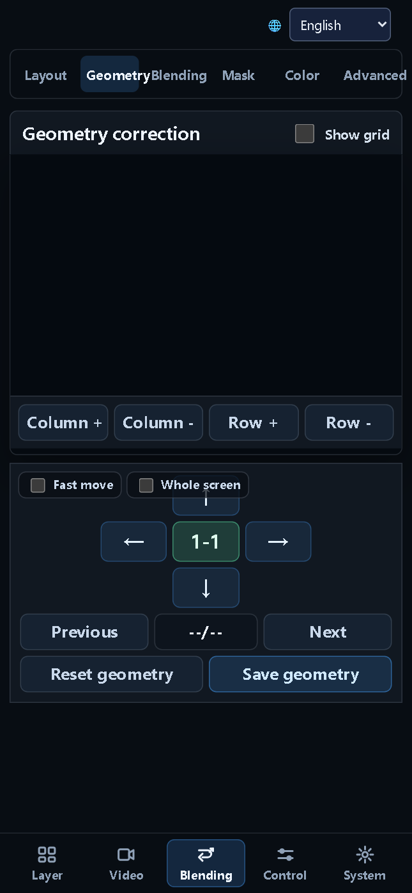

Figure 11 Fusion Mobile Interface

- Layout: select the matrix layout and choose Apply Layout. This changes how projection regions are organized; check whether existing calibration still suits the new layout.
- Geometry: enable geometry, select a region and point, and use direction controls to move it. Column+/Column-/Row+/Row- change grid density. Previous/Next changes regions. Restore Geometry and Save Geometry restore or submit geometry respectively.
- Mask: enable the global mask, select a point, and adjust it with direction controls. Restore Mask restores configuration; Save Mask submits it. The mask changes the final visible picture.
- Blend: select a region and blend-band point and use direction controls. Previous/Next changes regions; Restore Blend and Save Blend act separately. RGB, Gamma, Slope, and Anchor have decrement, increment, and reset controls.
- Color: use region-color Reset and Save Color. Previous Image, Show/Hide, and Next Image control the debug background. Background selection and color saving are separate actions.
- Advanced: initialize fusion; set matrix offset, scale, rotation, and keystone, then Apply Matrix Correction. Select a wall, eye distance, near/far planes, and three corners, then Apply CAVE Config. Initialize CAVE changes wall geometry.
- Quick panels: refresh and adjust available layers in Layer Matrix. Video Control selects a playlist and provides play, stop, replay, mute, and volume controls. Peripheral Configuration provides DMX/Serial/Network panels; System Config shows device state. Refresh rereads device values; visible controls depend on license and hardware.

### 7.9 Inspect Seams and Read Back

Align geometry with a grid, check seams on a uniform background, then inspect masks and region color. Save before changing projector region. When finished, refresh to read back, hide the test background, and restore playback. Confirm that videos paused for performance have resumed.

## Chapter 8 CAVE and Matrix Correction

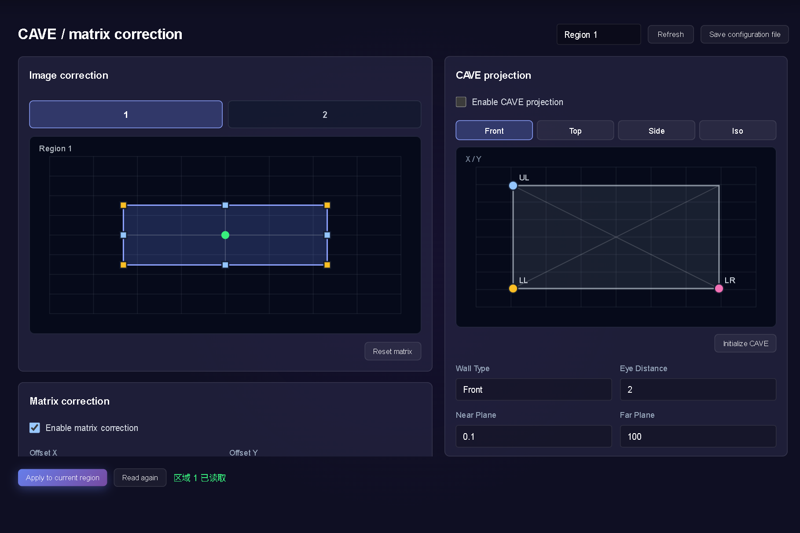

Figure 12 Matrix Correction and CAVE Wall Parameters

### 8.1 Region Selection and Matrix Values

Select a region and refresh its configuration. Dragging in the correction canvas automatically saves to the device. Matrix correction includes enable, Offset X/Y, Scale X/Y, Rotate Rad, and Keystone X/Y.

### 8.2 Wall Views and Three Corners

Enable CAVE projection, view Front/Top/Side/Iso, select Front/Left/Right/Floor/Ceiling, and set Eye Distance, Near/Far Plane, and X/Y/Z for the LL/UL/LR corners.

### 8.3 Initialize Apply Save and Reload

**Initialize CAVE** initializes wall geometry; **Reset Matrix** restores the correction matrix to defaults and saves it immediately; **Apply to Current Region** submits the current region; **Reload** discards unsaved inputs and rereads the device. **Save Config File** writes the current correction to the device file `projection_correction.json`; it is not a browser download. View buttons only change the camera view, while the selected wall owns its geometry and corner values.

### 8.4 Coordinates and Verification Order

Offset shifts the image, Scale changes size, Rotate Rad uses radians, and Keystone corrects trapezoidal distortion. LL/UL/LR are lower left, upper left, and lower right. Use one consistent scene coordinate scale for corners and eye distance. Select the wall, verify views and corners, apply, and reread the same region to compare geometry and values.

## Chapter 9 Stage Control and Cue Timeline

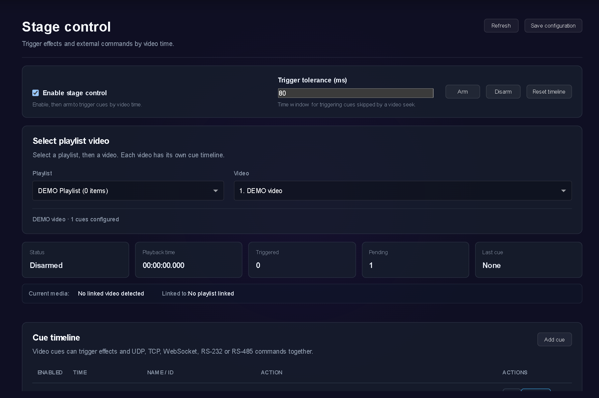

Figure 13 Stage Arming Media Selection and Status

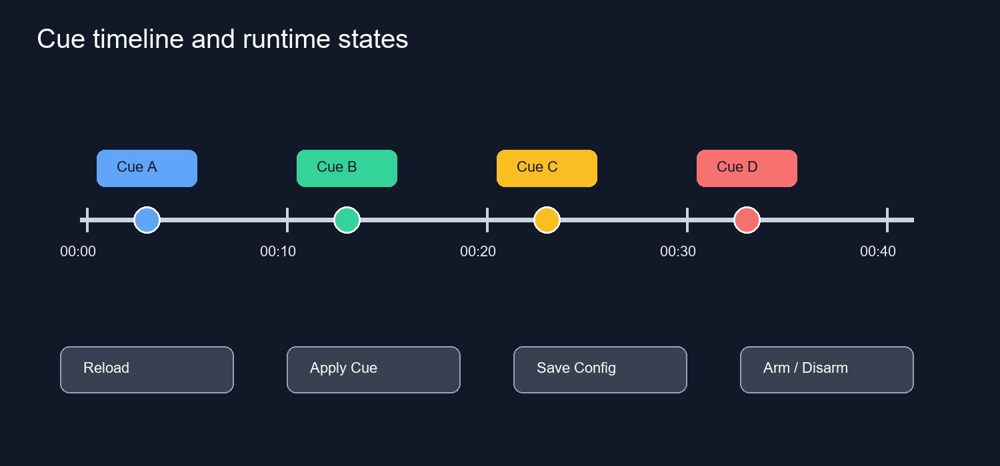

Figure 14 Cue Editing and Show Trigger Workflow

### 9.1 Bind a Playlist Video

Select a playlist and a video. Each video has its own Cue timeline. Refresh rereads configuration; Save Config submits the enabled state, tolerance, and Cues.

### 9.2 Enable Arm Disarm and Reset

Enable Stage Control, then select **Arm** to trigger Cues against playback time. **Disarm** stops triggering; **Reset Timeline** resets runtime timing. Trigger tolerance defines the time window for firing a Cue skipped by playback.

### 9.3 Edit Preview and Delete Cue Actions

Enable/disable each Cue and set its ID, name, trigger time, and action JSON. **Apply Cue** updates the selected video's configuration in the page; **Save Config** is still required to write it to the device. List actions include edit, preview, and delete. Preview executes the Cue immediately. Actions can invoke effects and UDP, TCP, WebSocket, RS-232, or RS-485 communication; the backend validates them. Before testing, verify network addresses, ports, serial ports, and receiving equipment to prevent unintended device actions.

### 9.4 Add Apply Cancel and Save

Cue editing also provides **Cancel** and **Add Cue**. Save before changing the selected playlist/video so unsaved page edits are not lost.

### 9.5 Runtime Status and Errors

Status shows bound media, playback time, armed state, fired/pending counts, last Cue, and errors.

### 9.6 Time Format and Action JSON Example

Enter a trigger time as `HH:MM:SS.mmm` or integer milliseconds; `00:00:05.000` and `5000` both mean five seconds. Tolerance is 0–2000 ms. A Cue ID must be unique within the video, 1–128 characters, using letters, digits, periods, underscores, or hyphens. The action editor requires a nonempty JSON array. This example selects effect 8 on layer 1 without sending peripheral commands.

```json
[
  {"kind":"effect", "layer_id":1, "effect_no":8, "effect_params":{}}
]
```

Enter the example → Apply Cue → Save Config → preview one Cue → arm and play the bound video. Recheck bindings and Cues when replacing playlist media.

## Chapter 10 Peripheral Configuration and Communication

### 10.1 DMX512 Input and Simulation

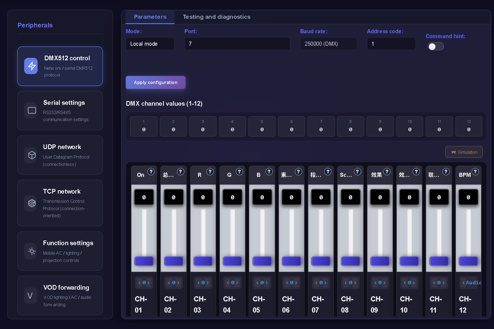

Figure 15 DMX512 Input and Simulation

DMX512: choose local/external mode, port, baud rate, and start address. Adjust channels 1–12 using the controls; switch between live data/manual modes as available; click **Apply Configuration**. Check address ranges and wiring.

### 10.2 Serial Ports and Wall Panel Templates

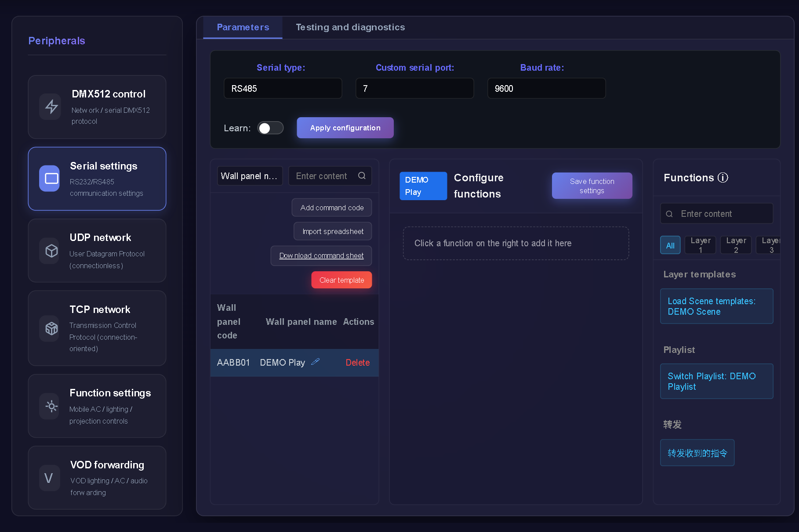

Figure 16 Serial Ports and Wall Panel Templates

RS232/RS485: choose serial type, port/device path, and baud rate. **Learn Mode** requires a valid serial number or device path and refreshes learned results while enabled. Add, import, search, select, rename, or delete wall-panel command templates. Excel/CSV imports require unique “墙板编码” and “墙板名称” columns in the first row; each import accepts 1–1,000 rows and files up to 2 MB. Clear Templates removes every template for that serial type.

### 10.3 Bind Template Functions

Template functions: filter by All or Layer 1–4, bind functions to the selected command, and save. Layer filters only change the displayed list.

### 10.4 Protocol Forwarding and Command Mapping

Template forwarding and fixed send: A received command can also be forwarded to RS232, RS485, UDP, TCP, or WebSocket. Fill in the serial port, address/port, or multicast group as required; choose direct/broadcast, UDP broadcast/multicast, fixed Hex/text payload, or command mappings. Unmatched mappings pass the original command through; multiple mappings for one input are sent in list order. Confirm the dialog, then save the parent template functions.

### 10.5 UDP Listener and Trigger Templates

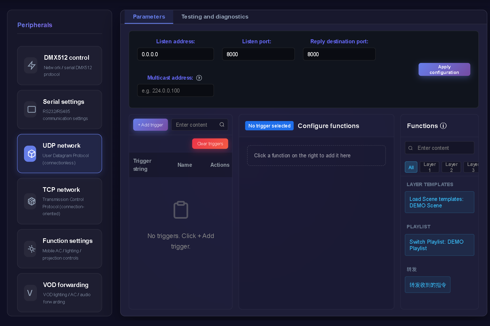

Figure 17 UDP Listener and Trigger Templates

UDP: set bind address/port, reply target port, and optional multicast address. Add, search, rename/delete trigger strings, bind functions executed on a match, and save. Clear Triggers removes all templates for that protocol.

### 10.6 TCP Mode and Trigger Templates

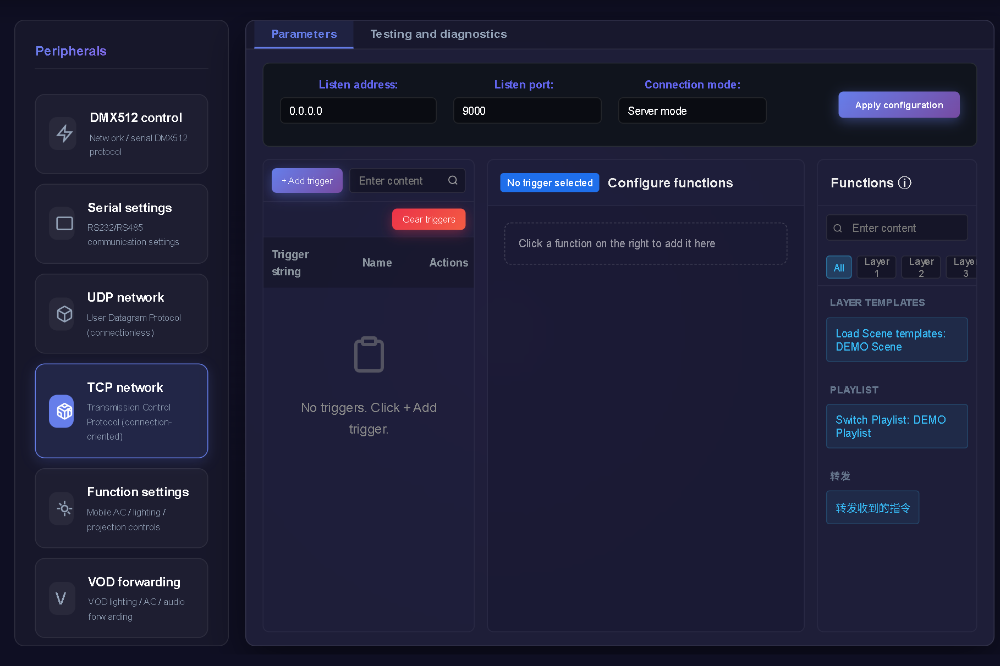

Figure 18 TCP Mode and Trigger Templates

TCP: set bind address/port and server/client mode. Trigger strings and function bindings work like UDP. After saving, verify any displayed client/server target settings and firewall rules.

### 10.7 Mobile Function Configuration

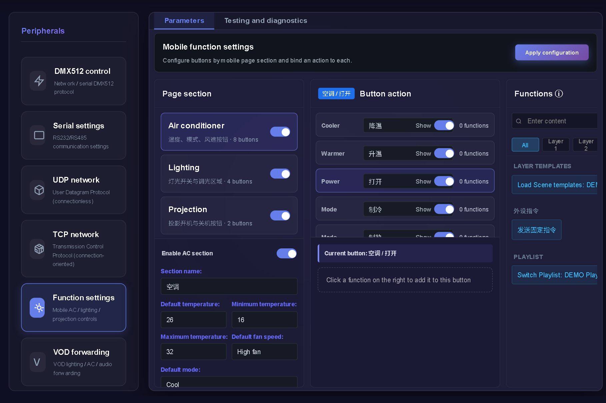

Figure 19 Mobile Function Configuration

Mobile Function Configuration: select a page area and button, bind an action from the function list, and apply. Buttons can control lighting, HVAC, projection, or layers depending on license and hardware.

### 10.8 VOD Event Forwarding

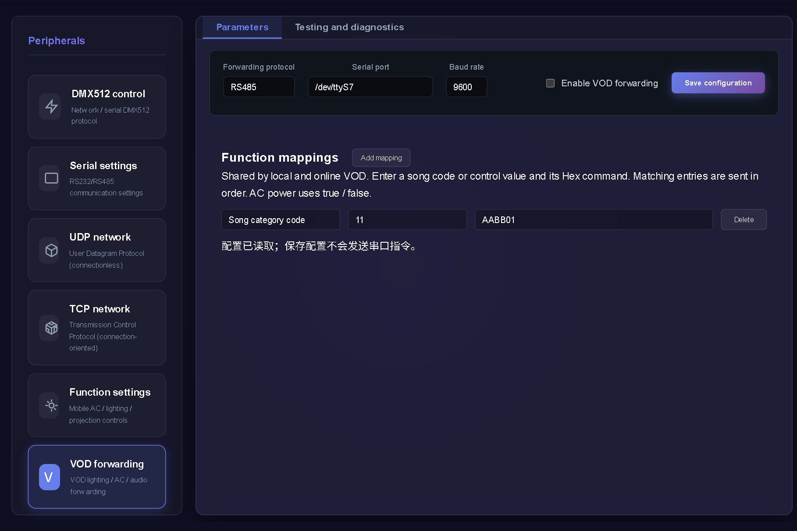

Figure 20 VOD Event Forwarding

VOD Forwarding appears when local or online VOD mode is enabled. Enable/disable forwarding, choose RS485/RS232, port/serial device, and baud rate. Add song/control event mappings and outgoing Hex. All matching mappings are sent in order; HVAC power values use `true`/`false`.

### 10.9 Test Sends and Interaction Log

Test & Diagnostics: choose the protocol/device, enter a complete Hex command, and send it. The interaction log shows results; Clear only clears the log. Test commands are sent to real peripherals, so verify the target and wiring first.

### 10.10 Import Tables and Verify Learning

1. Save the RS232 or RS485 port settings first.
2. Add a command manually or enable Learn Mode and operate the physical panel.
3. For Excel/CSV import, use unique headers `墙板编码` and `墙板名称`; import 1–1000 rows and no more than 2 MB per file.
4. Search imported templates and verify code and name.
5. Add functions and save, then operate the panel and inspect receive, match, and execution logs.
6. Disable learning when finished to avoid recording unrelated traffic.

### 10.11 Save Levels and Mobile Button Details

1. Save protocol settings first, such as serial port/baud rate or network bind address/port.
2. Select a wall-panel command or UDP/TCP trigger template. Add one or more functions from the function list and remove unwanted bindings. A forwarding function also needs its target protocol and send parameters.
3. Select the corresponding Save Function Config action. Confirming a dialog only accepts that dialog; it does not replace saving its parent template.
4. Trigger the real wall panel or use Test & Diagnostics. Check interaction and command logs for the received command, matching template, and correct send target.

Mobile Function Configuration also enables/disables HVAC, lighting, and projector areas; edits area titles and button labels; sets HVAC default/minimum/maximum temperature, default mode, and fan speed; controls dimmer availability and default brightness, each light's default on/off state, and projector on/off actions. Select a button, bind functions, apply configuration, then check the actual mobile page's appearance and operation.

### 10.12 Verify a Forwarding Rule

Add a forwarding target to the selected template and verify protocol, address/serial port, and port/baud rate. Choose fixed payload or command mapping, confirm the dialog, then save the template functions. Trigger one known command and check received bytes. Verify raw passthrough for unmatched mappings, and check order and duplicates when multiple targets or mappings apply.

## Chapter 11 System Settings and Maintenance

### 11.1 License Information and Import

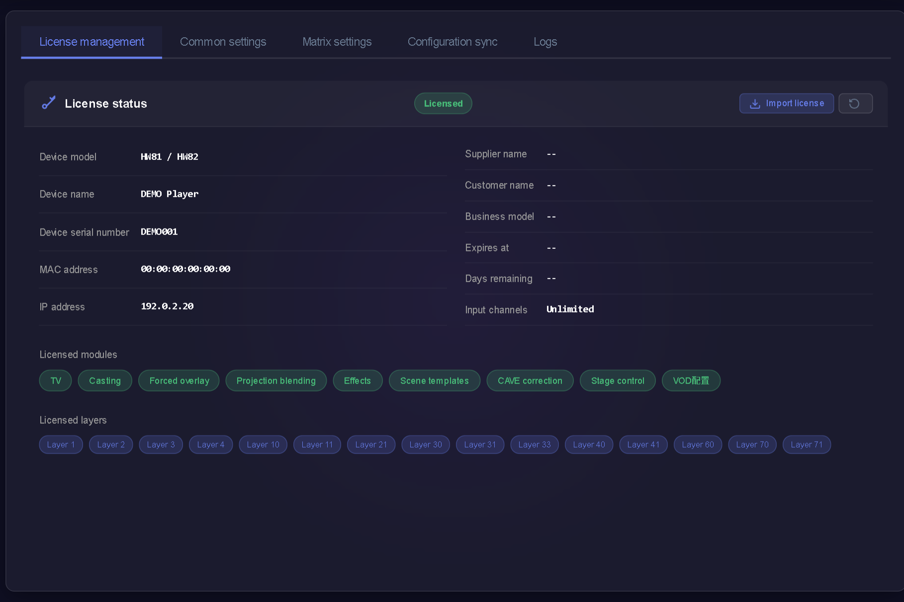

Figure 21 License Information and Import

License Management: inspect license status, device model/name/serial/MAC/IP/fingerprint, supplier/customer, business mode, expiration, and licensed modules; import a license file. Use a trusted license matching this device.

### 11.2 Common Configuration Overview

Common Configuration contains schedules, network, synchronized playback, VOD, display, and options. Lyrics and subtitles belong to the VOD category. See 11.10–11.16 for field details. Click Save Config after editing.

Startup wireless mode needs a system reboot; render quality and lyric font need an app restart. Resolution changes may briefly blank the display. Follow on-screen timing for other fields.

### 11.3 Matrix Input Output and Reload

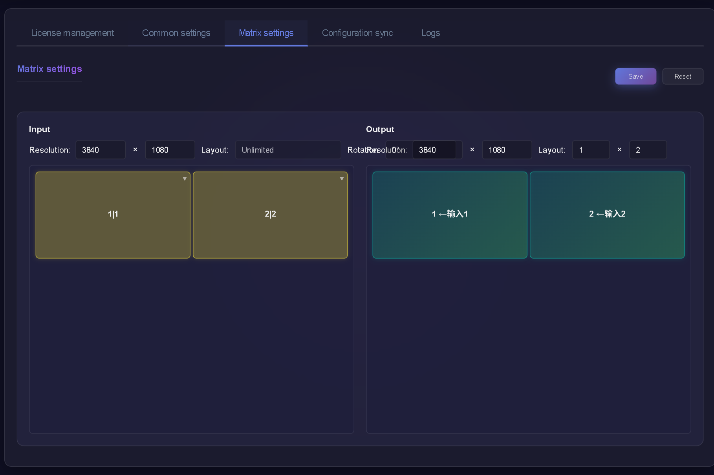

Figure 22 Matrix Input Output and Reload

Matrix Config: inspect/edit input and output resolution, row/column layout, and canvas rotation. Input/output routing fields depend on the device. Save applies and persists the new matrix and may change projection/playback regions. Reset reloads saved settings; it does not restore factory defaults. Check playback distribution and licensed channel count first.

Click an input-region cell to choose Output to Screen N or Disable Output. The output grid shows its input source. Verify every region mapping and click Save. Input layout is limited by licensed channels; recheck all mappings after changing resolution, layout, or rotation.

### 11.4 Display Output and Resolution

Under Display Config, **Display Output** saves HDMI/MIPI selection; use **Reboot** when the page reports a pending reboot. On supported devices, confirm a system-resolution change; the display may briefly blank. Retry failed reads.

### 11.5 License Service Address

An editable License Server Address and save action may also be shown. Confirm the correct service address before changing it.

### 11.6 LAN Sync and Full Backup Restore

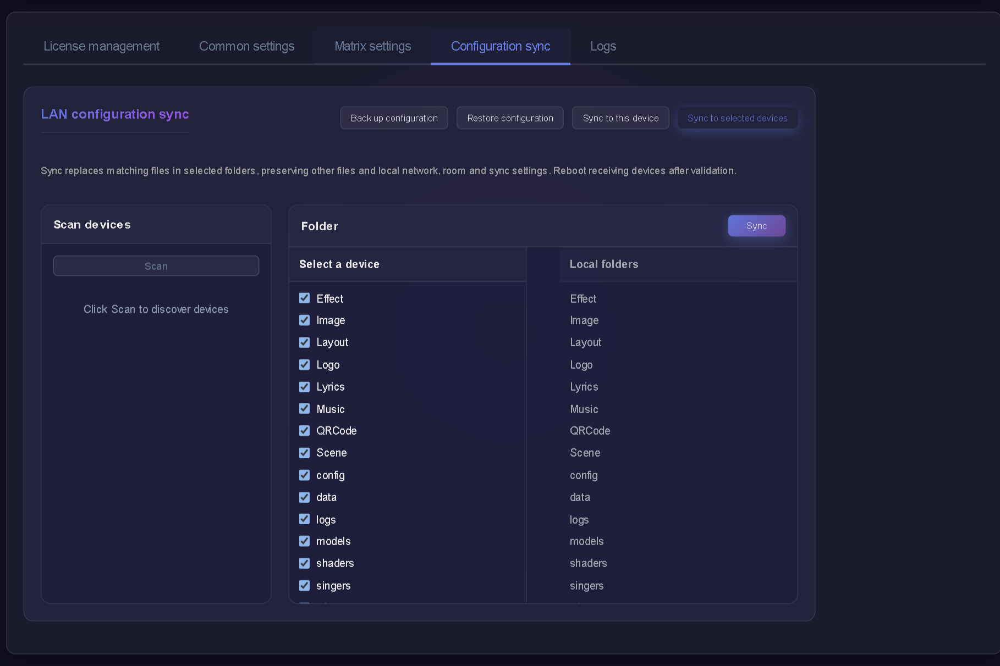

Figure 23 LAN Sync and Full Backup Restore

Config Sync: choose **Pull to This Device** or **Push to Selected Device**, scan LAN devices, select the source/target and one or more folders, then sync. Only selected folders are processed; same-named files are overwritten, while the target device's network, room, and sync-group settings are preserved. The receiver requires a system reboot after full verification. Separate **Back Up Config/Restore Config** exports or uploads a complete ZIP: backup downloads `hsvj-config-timestamp.zip`; restore accepts a non-empty ZIP up to 8 GB, verifies it, and reboots the device. If a verified restore is waiting but the reboot request was not confirmed, click Restore Config again to retry the reboot; do not upload repeatedly while reboot is pending. Full restore replaces participating configuration directories and can remove old files absent from the backup. Video is excluded; device licenses and ROM update/download directories are preserved and are not migrated through this backup. Full restore and LAN sync have different preservation rules. Verify the source and preserve the current device state before a full restore.

### 11.7 Browse Search Download and Delete Logs

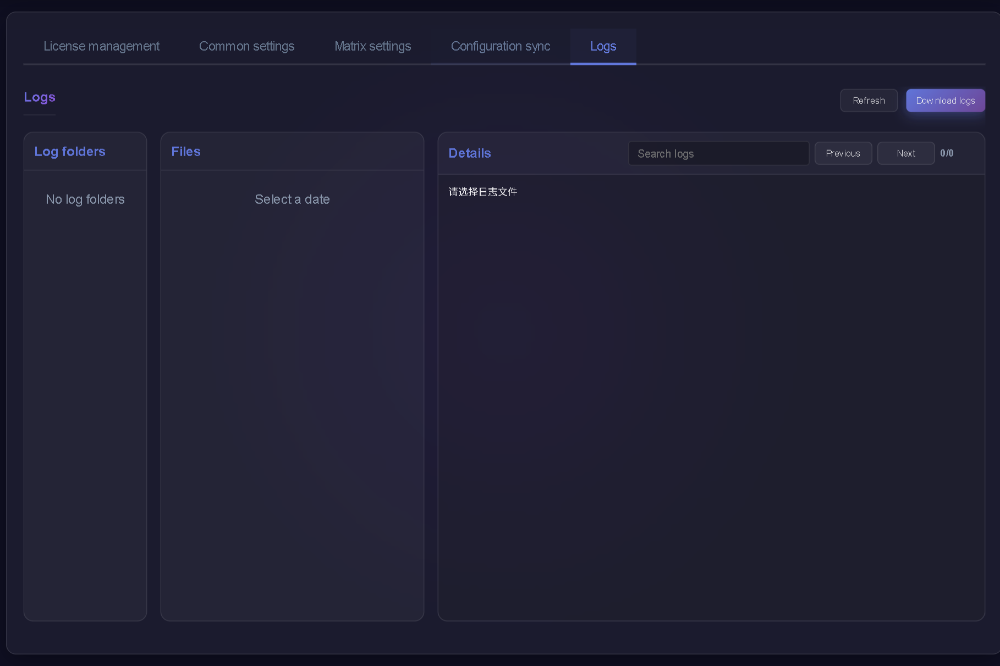

Figure 24 Browse Search Download and Delete Logs

Log Management: requires the log-management password. Browse logs by date/file, open details, download, or delete a date/file. Search within details and move to previous/next match. Deletion is permanent. Check logs for network/device information before sharing.

### 11.8 Factory Serial Maintenance Page

A factory serial-number page may be provided separately by the device administrator. It shows current/pending serials. Enter 1–14 alphanumeric characters beginning with a letter and select **Write Serial and Reboot**. The page verifies the written value and schedules a reboot in 2 seconds. If the result is uncertain, reread before taking action; do not write the same serial repeatedly.

### 11.9 Hidden Maintenance Entries

Hidden actions: click Device Name 10 times within 2 seconds to edit the device name; click Supplier Name 10 times within 2 seconds to open boot-animation selection. These are not standard menu items. Confirm the selected animation before applying.

### 11.10 Scheduled Power

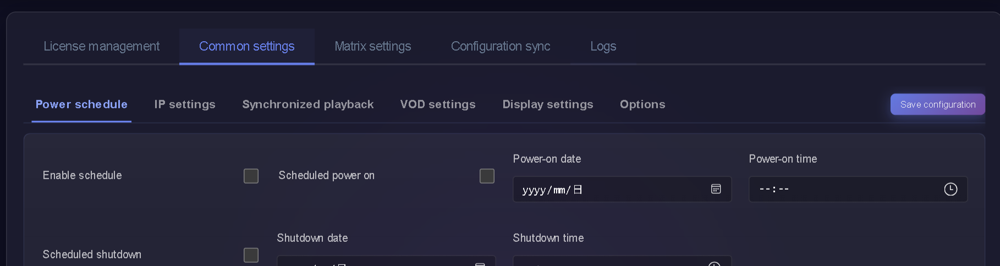

Figure 25 Scheduled Power

Schedule: the master switch enables scheduled power on/off. Enter separate dates and times for power on and off. Check the device clock and installation schedule before saving.

### 11.11 IP Wireless and USB OTG

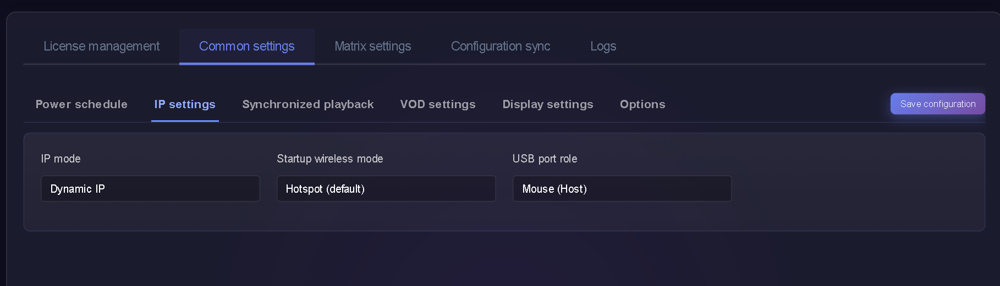

Figure 26 IP Wireless and USB OTG

Network: dynamic IP uses automatic addressing. Static IP requires a correct IP, gateway, and DNS. Reconnect at the new address after an IP change. Startup wireless mode chooses hotspot or Wi-Fi at the next boot. USB Host supports host peripherals, Peripheral uses device mode, and Auto follows hardware support.

### 11.12 Synchronized Playback

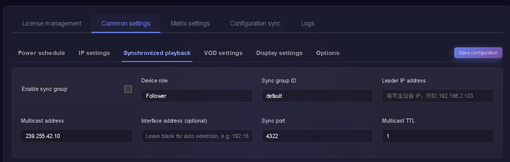

Figure 27 Synchronized Playback

Sync Group: select enabled state, leader/follower, and group ID. Followers need the correct leader IP. Multicast address, port, interface address, and TTL must match the network plan. This synchronizes running devices and is separate from folder configuration transfer.

### 11.13 VOD Source Room and Audio

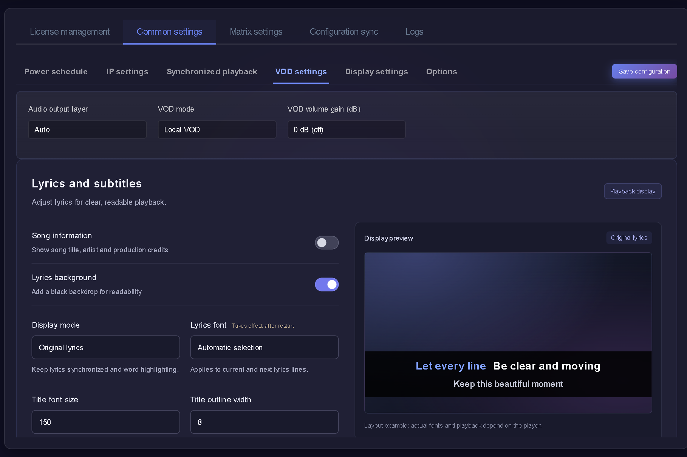

Figure 28 VOD Source Room and Audio

VOD: Audio Output Layer selects the playback audio target; Local/Online mode selects the VOD source. Online mode needs a server host and room ID. Gain is adjusted in dB. Test a real song request to confirm audio, lyrics, and the target layer.

### 11.14 Display Frame Rate and Quality

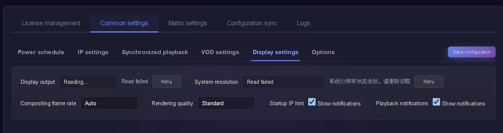

Figure 29 Display Frame Rate and Quality

Display: HDMI/MIPI selects the output; System Resolution selects the system output mode. Render frame rate and quality affect display performance. Hardware limits available values; confirm, save, or restart as prompted.

### 11.15 Startup and Update Options

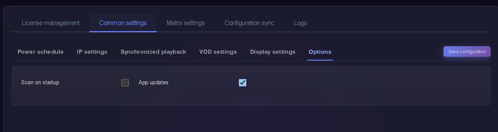

Figure 30 Startup and Update Options

Options: Startup IP Hint controls the startup network hint; Playback Operation Hint controls playback feedback. Startup Scan controls local-song scanning at startup. App Update controls the associated update option.

### 11.16 Lyrics Subtitles and Fonts

Lyrics and Subtitles: set lyrics/subtitles, song information, background, original/pinyin display mode, and font. Title size/outline and lyric size/outline/character spacing adjust their respective text. Producer Text sets the producer information displayed with song information. Check the preview and save. Font changes require an app restart.

### 11.17 Full Restore Versus LAN Sync

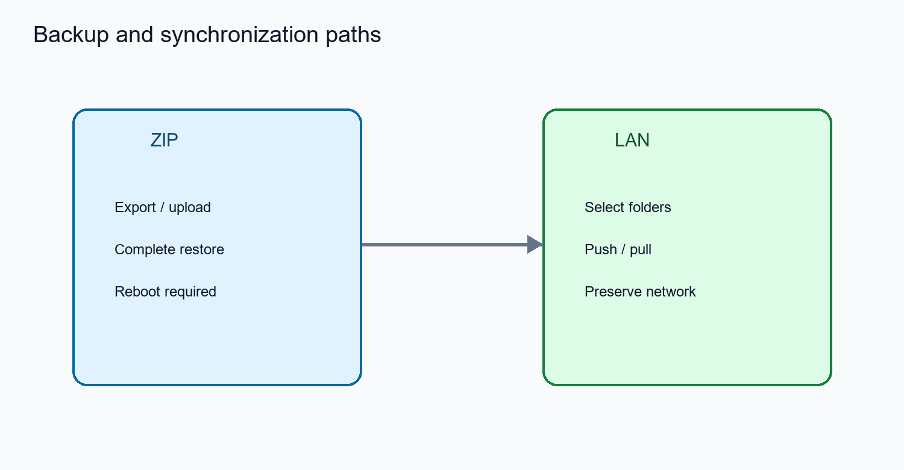

Figure 31 Backup Sync and Reboot Boundaries

| Operation | Scope | Completion |
|---|---|---|
| Playback sync group | Coordinated playback | Verify role and group values, then test playback |
| LAN configuration sync | Selected folders, overwrite same names | Receiver verifies and reboots; network, room, sync group retained |
| Full ZIP restore | Replacement of participating config directories | Verify and reboot; video excluded, license and ROM directories retained |

## Chapter 12 Troubleshooting

### 12.1 Common Symptoms and Check Order

- Connection failure: verify the browser uses `http://IP:8080/` and can reach the player on the network, then refresh.
- Missing module/layer: check license status and hardware model. Unlicensed modules and unavailable layers may be hidden or read-only.
- Values differ: use the module's Refresh/Reload action to read server state; continue after the save is confirmed.
- Playback/mirroring issue: check System Status and the command log, then verify video-layer input, capture signal, mirroring connection, and system audio route.
- A request may have reached the device even if the browser timed out. Wait for recovery and refresh the relevant page before repeating restart, restore, delete, or peripheral-send actions.

### 12.2 Feature Specific Troubleshooting

| Symptom | Check First | Verify Recovery |
|---|---|---|
| Blank or misplaced image | Visibility, opacity, position, matrix, input | Test one layer with known media |
| Upload failure | Source, destination, space, write access | Refresh and confirm file before adding it |
| DMX does not respond | Mode, wiring, start address, CH01, simulation | Clear simulation and inspect live channels |
| Panel matched but no action | Serial template, functions, outer save | Send one command and compare logs |
| Cue does not fire | Enabled, armed, media binding, time, tolerance | Preview first, then play the bound video |
| Seam or mask defect | Region, geometry, blend edges, mask, background | Preserve config before component restore |
| No audio | Layer/system volume, mute, channel, track, DSP | Trace known audio through the route |
| Lost access after IP change | New IP, gateway, computer subnet | Sign in at the new address and reread |
| Restore awaiting reboot | Verification and reboot request result | Finish reboot; avoid repeated ZIP uploads |

### 12.3 Information for Support

Record model, serial, IP, software version, operation time, page, reproduction steps, expected/actual behavior, and relevant logs. Include layout and region images for picture problems, or protocol values and complete sent/received payloads for peripheral issues.

## Chapter 13 Commissioning Workflows

### 13.1 First Commissioning

1. Check the device in System Status, then confirm module and layer permissions in License Management.
2. Set network, VOD, and display output in Common Config. Save, restart as prompted, and reconnect.
3. Configure input canvas and output layout in Matrix Config. Create layers, adjust position and size, and save the scene in Layer Matrix.
4. Upload materials, create a playlist, and add materials. Confirm playback before setting a default playlist.
5. Adjust geometry, blend, mask, and color for the installation and save each configuration. Check the selected region separately for CAVE correction.
6. Configure peripheral triggers, forwarding, and Cues last. Test each receiving device, then download a configuration backup and any logs needed for support.

### 13.2 Two Region Projection Workflow

1. Check licensed input channels and output sizes, create a two-region matrix, and save.
2. Arrange video or capture layers, save the scene, and play test material.
3. In blending, work region by region: align geometry, then overlap edges and curves.
4. Check mask, brightness, contrast, and saturation, then save.
5. For CAVE, select the wall and region separately, apply, and save the config file.
6. Hide test backgrounds, resume media, read back, verify after restart, and back up.

### 13.3 Verify Wall Panel and Video Cue Together

1. Save serial values and learn or import a wall-panel template.
2. Bind the required function and save the template functions.
3. Add a five-second Cue to the target playlist video, apply it, and save config.
4. Preview the Cue, verify its action, then arm.
5. Start the target playback from the panel; inspect serial logs, playback time, and the fired count.
6. Disarm and confirm triggers stop, restore the required operating state, and back up.

## Chapter 14 Parameters and Keyboard Reference

### 14.1 Save Apply and Restart Reference

Refresh/Reload reads device state and does not save inputs. Save/Apply acts within its module; Cue editing and template dialogs can still require a parent save. Layer dragging, CAVE dragging, playback, preview, and command sends affect the device directly. A pending-restart state after verified restore or LAN sync means data has been checked but application is incomplete; reboot before checking the result. If no success response arrives, reread actual state first.

| Object | Submit | Verify |
|---|---|---|
| Layers and scenes | Property save, Save, or Save As | Reselect scene and layer |
| Blending | Save or Ctrl+S | Refresh the current region |
| CAVE | Apply region and Save Config File | Reload |
| Cue | Apply Cue then Save Config | Refresh bindings and Cue list |
| Peripheral template | Confirm dialog then save functions | Physical trigger and logs |
| Common configuration | Save, restart as prompted | Read back and inspect output |

### 14.2 Complete Blending Keyboard Reference

Desktop fusion shortcuts: Arrow keys select a point; Ctrl+Arrow nudges it by 2 pixels; Ctrl+Alt+Arrow moves it by 5 pixels (Ctrl+Alt+W/A/S/D also works); Shift+Arrow or Ctrl+Shift+Arrow moves a row/column; Alt+Shift+Arrow moves blend-manager edges; Ctrl+Shift+Alt+Arrow moves the whole projector region; A/D add/remove columns and W/S add/remove rows; N/H next/previous region; K switches straight/curved interpolation; G toggles geometry; M toggles mask; I switches fusion mode; Alt+W toggles the blend band; -/+ changes grid-line thickness; Ctrl+-/+ changes point size; Ctrl+Z undoes; Ctrl+Shift+Z initializes geometry/mask/blend; Ctrl+G, Ctrl+I, and Ctrl+M restore geometry, blend, and mask; Ctrl+S saves; P shows movement steps. Use shortcuts while the fusion canvas has focus. Initialization and restore actions change calibration data.

### 14.3 Twelve Channel DMX Mapping

The question-mark button on each channel shows this version's value mapping. Sliders and decrement/increment controls change values. Simulation locks current values; clearing simulation returns to live reception. Channel numbers below are relative to the configured start address.

- CH01 Enable: 0 disables DMX control and restores runtime state; 1-255 enables it.
- CH02 Master Brightness: 0 is black; 1-255 goes from dark to bright.
- CH03 Red, CH04 Green, CH05 Blue: 0 disables that color; 1-255 increases intensity. All three at 0 disables material color overlay.
- CH06 Material Directory: 0 keeps the current selection; 1-10 selects the playlist with DMX ID 10, 11-20 selects ID 20, and so on in groups of 10. Assign the correct DMX ID in playlist settings first.
- CH07 Material: 0 defaults to the first item; 1-5 selects item 1, 6-10 item 2, 11-15 item 3, and so on in groups of 5.
- CH08 Scene: 0 keeps the current scene; 1-5 selects scene 1, 6-10 scene 2, and so on.
- CH09 Effect: 0 disables effects; each group of 5 selects an effect in the current valid sequence. Unassigned values keep the current effect. Effect IDs are different from DMX bucket values; use the question-mark help for the current mapping.
- CH10 Effect Color: 0 default/rainbow; 1-5 red, 6-10 green, 11-15 blue, 16-20 white, 21-255 rainbow. Only color-responsive effects change; the fixed black-background video mask does not.
- CH11 Link: 0 controls only the layer bound to the CH06 playlist; 1-50 links layer 2, 60-100 layer 3, 110-150 layer 4, and 160-255 layers 1-4. Avoid unlisted gaps.
- CH12 BPM: 0 uses audio detection. Values 5/10/15/20/25/30/35/40/45 correspond to 95/115/118/126/128/132/140/150/155 BPM. Prefer the values offered by the page.

### 14.4 Complete Current Effect ID Catalog

Numbers below are effect IDs, not DMX values. For each effect, select the target layer, add/preview it, enable linkage, and save. Remove it to exit that effect.

- 1 White Flash and 2 Black Flash follow beats; 3 Red Flash, 4 Green Flash, and 5 Blue Flash create pulses of the corresponding color.
- 6 Black Bar Scan moves left to right on a strong beat; 7 Center Iris contracts to a small central circle; 8 RGB Outline separates color channels; 9 Invert reverses colors; 10 Scanlines adds television-style horizontal lines.
- 12 Chase Light moves a segment along the edge; 13 Split Curtain reveals the picture from the center; 14 Scale creates breathing zoom; 15 Rotate continuously rotates; 16 Color Sweep adds a horizontal light band; 17 Auto Split switches between 4/6/9/12 panels with audio intensity.
- 18 Circle, 19 Triangle, 20 Rounded Rectangle, 21 Star, 22 Hexagon, 23 Diamond, 24 Heart, and 25 Petal temporarily crop the target layer to that shape.
- 26 LOGO Show creates an opening logo light pattern; 27 Emotion adds red hearts; 28 Soul creates enlarged trails; 29 Shake offsets RGB channels; 31 Glitch adds horizontal displacement and dispersion; 32 Hallucination creates color trails; 33 Cube rotates a video-textured cube.
- 34 Edge Marquee moves several light bars around edges; 35 Beat Echo creates frozen layers and color echoes; 36 Neon Outline brightens glowing edges on beats; 37 Liquid Glass uses audio-driven refraction; 38 Kaleidoscope rotates mirrored segments; 39 Beat Shape Split triggers split patterns; 40 Shape Stitch stretches circular video windows into rounded vertical bars on a black background.

### 14.5 Units and Input Limits

| Parameter | Unit or Limit |
|---|---|
| Layer position and size | Pixels |
| Layer opacity | 0–255 |
| Layer and matrix rotation | Layer: degrees; Rotate Rad: radians |
| Crop | 0–100 percent for each edge |
| EDID width height refresh | Width 320–4088, multiple of 8; height 240–2160; integer 24–60 Hz |
| Cue time and tolerance | Milliseconds or HH:MM:SS.mmm; tolerance 0–2000 ms |
| Serial template import | 1–1000 rows; up to 2 MB |
| Full ZIP restore | Nonempty ZIP; up to 8 GB |
| Factory serial | Alphanumeric, starts with a letter, 1–14 characters |

## Chapter 15 Feature Coverage and Handover

### 15.1 Feature Coverage Index

| Feature Scope | Location |
|---|---|
| Login, language, navigation, restart | Chapter 1 |
| Status, resources, playback, command log | Chapter 2 |
| Layers, slices, crop, capture, EDID, mirroring, text, QR | Chapter 3 |
| Materials, cloud, SATA, optimization, playlists, audio, DSP, streams | Chapter 4 |
| Scene JSON, default configuration, deletion | Chapter 5 |
| Effects, color, outline, audio analysis and learning | Chapter 6 and 14.4 |
| Blend, geometry, mask, color, mobile client | Chapter 7 and 14.2 |
| CAVE, matrix, walls, config file | Chapter 8 |
| Cue editing, preview, arm, disarm, timeline | Chapter 9 |
| DMX, serial, UDP, TCP, forwarding, mobile functions, VOD, diagnostics | Chapter 10 and 14.3 |
| License, schedules, network, sync group, display, VOD, lyrics, matrix | Chapter 11 |
| LAN sync, ZIP backup/restore, logs, serial, hidden maintenance | Chapter 11 |
| Troubleshooting, deployment, save boundaries, input limits | Chapters 12–14 |

### 15.2 Acceptance Checklist

| Check | Pass condition | Evidence |
|---|---|---|
| Login and license | Page is reachable and module entries match the license | License page and serial |
| Matrix and layers | Input/output layout, layer positions, and scene are saved | Read-back result |
| Playback | Video/image/audio plays and the list can be replayed | Playlist name and logs |
| Peripheral | Trigger, send, and receive logs agree | Command/interaction log |
| Fusion/CAVE | Regions are continuous and remain correct after restart | Geometry/matrix read-back |
| Backup | ZIP or LAN sync completes and receiver restarts | File name and reboot result |

Support package: device IP, model, serial, software version, reproduction steps, time-window logs, and the last known good configuration.

This manual follows the current implementation. Page names, fields, and licensed modules may change by version.

### 15.3 Handover Materials

Retain the device inventory, network values, default scene and playlist names, peripheral templates, Cue test results, blending/CAVE readback, backup ZIP filename, and logs. Record the verification time after the last restart for future maintenance.
