# HVIDEO 调试页面用户手册

完整图文版  第二版  2026年11月14日

适用人员：设备部署、现场调试、演出操作和维护人员。本手册覆盖桌面调试页面、融合移动页和独立维护入口。按功能章节查找操作，也可按第13章完成一次部署。

## 阅读说明

每个功能先确认操作对象，再修改、保存、回读。拖动图层、播放预览、Cue 预览和外设发送会立即作用于设备。未授权模块可能隐藏；字段和可选值以当前设备页面为准。

图中数字是正文定位标记。带 DEMO 的设备、地址、素材和数值用于演示页面布局；请替换为现场参数。截图展示当前页面，部分局部示例使用已有设备截图。示意图用于说明操作关系。

## 章节目录

1. 访问登录与使用准备

2. 系统状态与命令日志

3. 图层矩阵与图层属性

4. 视频素材与播放控制

5. 场景模板与默认配置

6. 特效与音频反应引擎

7. 投影融合与移动端调试

8. CAVE 与矩阵校正

9. 舞台控制与 Cue 时间轴

10. 中控配置与外设通信

11. 系统设置与维护

12. 故障排查

13. 现场操作案例

14. 参数与快捷键参考

15. 功能覆盖与交付检查

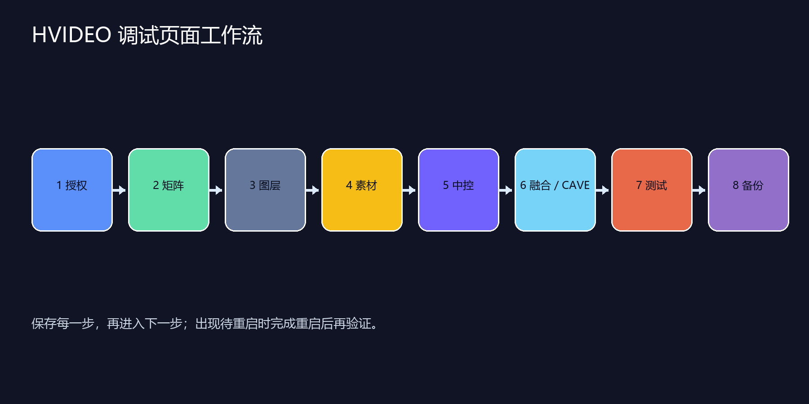

图 1 完整调试顺序

## 第1章 访问登录与使用准备

### 1.1 连接与登录

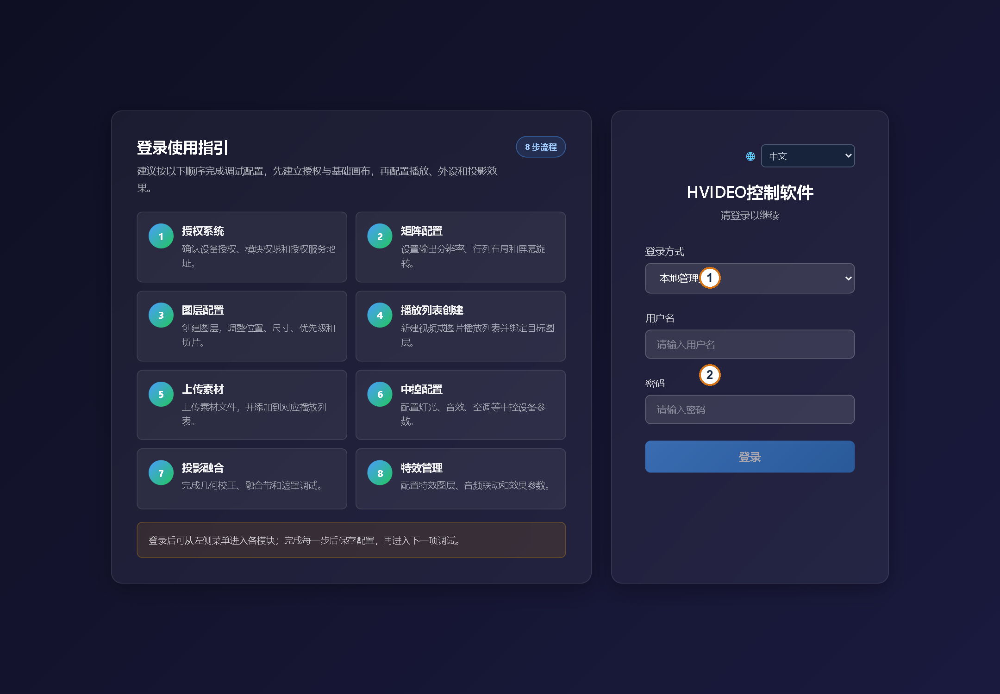

图 2 登录方式与账号输入

1. 将电脑或平板接入播放器控制网络。
2. 在浏览器打开 `http://播放器IP:8080/`。
3. 选择本地管理员或云端代理商，输入对应账号和密码后登录。
4. 登录后核对设备名称与 IP；会话失效时重新登录。
5. 右上语言选择用于切换界面语言。账号由设备部署方提供。


① 登录方式；② 账号和密码区域。

### 1.2 导航与授权边界

左侧导航依次为系统状态、图层矩阵、视频控制、场景模板、特效管理、投影融合、CAVE 校正、舞台控制、中控配置、系统设置。菜单可收起。场景、特效、融合、CAVE、舞台和 VOD 配置受模块授权控制；图层池也受授权控制。先到系统设置核对授权，模块缺失不应通过重复刷新处理。

### 1.3 重启与操作中断

“重启软件”重启播放器应用；“重启系统”重启设备。执行前保存修改，并确认现场允许中断播放。部分操作需要二次确认。网络中断时先刷新状态确认实际结果，避免重复执行重启、删除或还原。

## 第2章 系统状态与命令日志

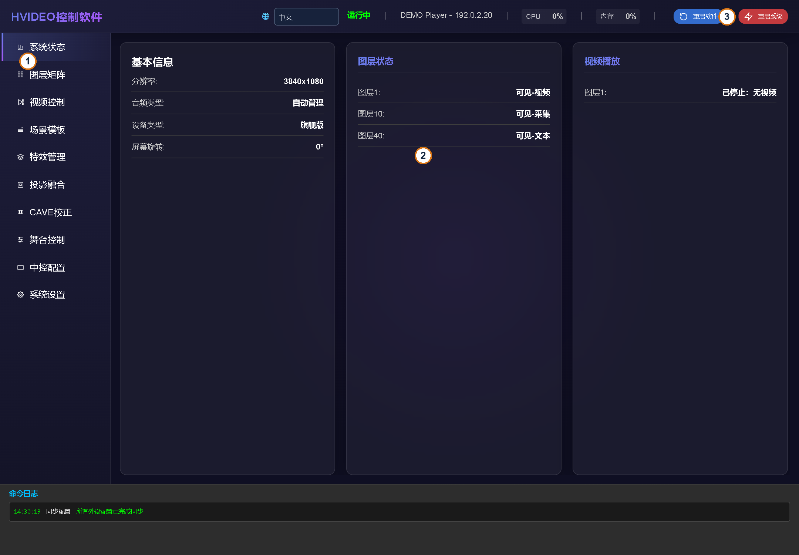

图 3 状态页的观察区域

① 左侧导航；② 设备、图层与播放状态；③ 顶部资源状态和重启入口。

### 2.1 读取状态

显示设备基本信息：分辨率、音频类型、设备类型和屏幕旋转；“图层状态”显示各图层状态，“视频播放”显示当前播放信息。顶栏持续显示系统状态和资源占用。此页主要用于观察，无配置保存操作。

### 2.2 命令日志与结果确认

命令日志显示操作时间、项目和成功/失败信息。操作后先看成功提示，再观察实际输出，最后刷新对应页面回读。系统状态用于观察，不需要保存。CPU 或内存读数仅用于判断趋势，不能代替现场画面检查。浏览器超时不表示设备一定没有执行。

## 第3章 图层矩阵与图层属性

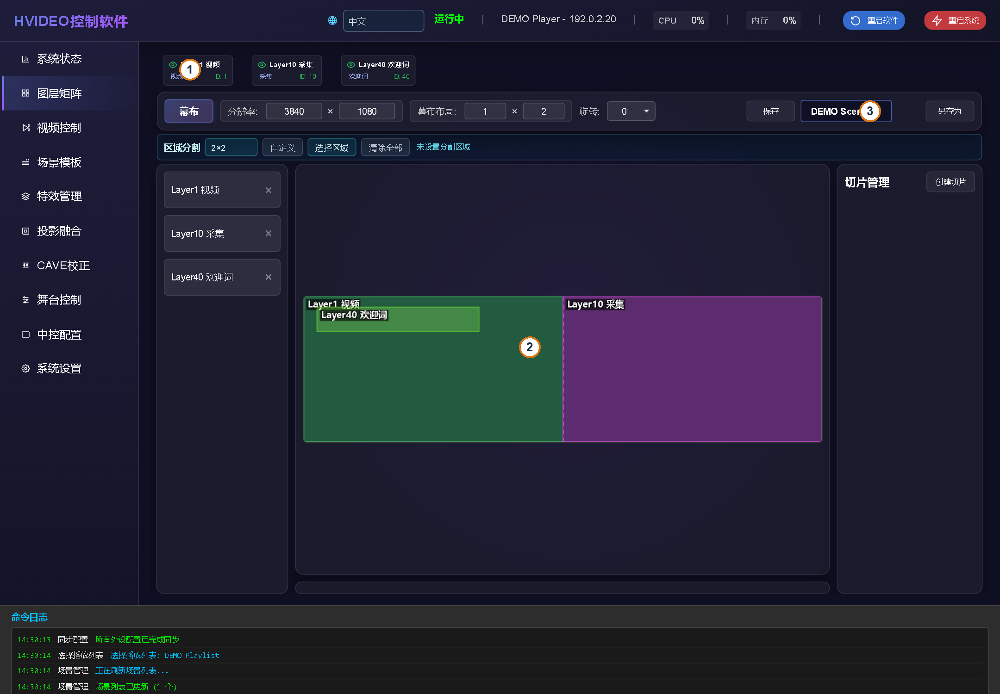

图 4 幕布图层与切片区域

① 授权图层入口；② 幕布及图层画布；③ 保存与另存为。下方属性随所选图层变化。

### 3.1 画布与只读幕布参数

画布显示幕布布局、图层和切片。顶部幕布宽高、行列和旋转是只读值。

### 3.2 选择拖动与数值精调

选择图层或切片可查看属性；拖动图层可改变位置，拖动边缘/控制点可调整大小或编辑区域。拖动会实时作用于运行画面；使用数字输入可精确设置坐标、尺寸、优先级、透明度和旋转。

### 3.3 多选吸附与右键菜单

图层可配合 Ctrl、Shift 或 Command 多选，拖动时支持对齐吸附辅助线；在图层上单击右键可打开快速对齐和按画布比例调整尺寸菜单。可按具体字段旁的复位控件恢复字段默认值。


快速对齐包括左、右、水平居中、上、下；比例尺寸菜单按画布宽或高取 1/2、1/3、1/4、2/3、2/4、3/4。尺寸菜单只修改对应维度，必要时位置会夹紧至画布内。

### 3.4 移除场景图层

图层列表中的删除按钮会从当前场景移除图层并隐藏运行层。只有已授权、可用的图层类型才能创建或编辑。

### 3.5 保存默认配置与另存场景

“保存”保存默认配置；下拉框切换场景配置；“另存为”将当前配置另存为命名场景。保存前确认当前选中的场景名称。

### 3.6 区域辅助分割

区域分割提供 2×2、3×3、4×4 和自定义行列数；“选择区域”后点击画布内目标区域应用辅助分割线，“清除全部”清除这些分割辅助线。

### 3.7 图层卡片与属性页签

图层卡片区域可横向拖动浏览；对已创建图层选择后属性面板显示“常用/高级”页签。位置与大小可从画布拖拽，也可用常用属性精确录入。

### 3.8 创建编辑与删除切片

“创建切片”可在选中图层下创建可独立显示和配置的子区域。切片支持常用/高级参数、显示/隐藏、保存和删除。删除前确认目标。

### 3.9 通用属性与参数范围

常用属性包括 X/Y、宽/高、优先级、透明度、旋转、音量以及适用的文本和字体字段。优先级 0–100，透明度 0–255，旋转 0–360 度，裁剪四边为 0–100%。先确认单位再用加减按钮微调；复位只作用于对应字段。


裁剪的上、下、左、右以百分比（0-100）调整素材边界；通用透明度范围 0-255，优先级 0-100，旋转角度 0-360 度；切片可独立配置可见性和裁剪。形状菜单的可用形状由当前页面列表给出，选择后若出现“形状参数”，继续设置对应参数。

### 3.10 视频图层

视频：音量、高斯模糊、填充/等比显示、四边裁剪、形状及形状参数、图像反转、黑色转透明、漫游方向/速度/范围/循环、旋转。

### 3.11 图片图层

图片：静态/动态显示、线性/最近邻过滤、淡入淡出和显示时长，以及通用形状、裁剪和位置参数。

### 3.12 文本歌词与提示

文本/歌词/提示：文本、字体、文字颜色、背景颜色或透明背景、居中/滚动显示、位置、对齐、显示列表、播放列表关联、字号、显示数量、时长及提示起止时间。具体字段随图层类型而异。

### 3.13 二维码图层

二维码：二维码内容、底部文字、边框颜色、位置、尺寸、优先级和融合调试开关。融合调试二维码还受“系统设置 > 公共配置 > 启动 IP 提示”控制。

### 3.14 采集输入与 EDID

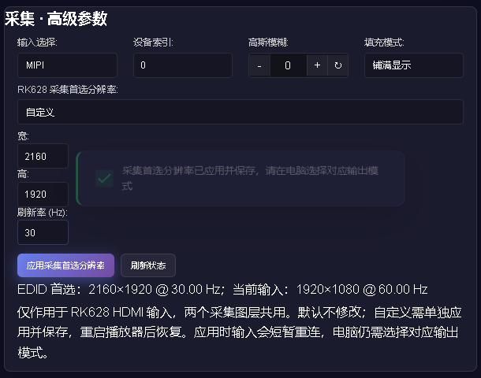

图 5 采集输入和 EDID 局部示例

采集图层：选择自动、HDMI、USB 或 MIPI 输入、设备索引、高斯模糊和显示比例。高级 EDID 设置可读取状态、选默认或自定义首选分辨率并应用；自定义宽度为 320–4088 且须为 8 的倍数，高度 240–2160，刷新率 24–60 Hz 的整数。应用自定义 EDID 后需在信号源电脑选择对应输出模式。

### 3.15 无线与 USB 投屏

投屏图层：苹果投屏、安卓/Windows 投屏和 USB 线镜像均可启动或刷新状态；苹果页面可重置 PIN。可设置未连接提示、应用启动时自动启动哪种投屏服务、电视投屏时自动切换的场景及上下裁剪像素。投屏方式和状态依设备支持情况显示。

### 3.16 特效图层

特效图层：填写特效 ID 和 JSON 参数；提交前确认 JSON 格式及目标图层。


### 3.17 布局操作验证

选一个可见视频层，将 X/Y 调整为目标值并检查实际画面。创建一个切片，分别验证原图层和切片的可见性。保存当前场景后切走再回读，确认位置、尺寸和切片仍在。采集输入改 EDID 后，在信号源电脑选择匹配模式，再确认播放器收到信号。

## 第4章 视频素材与播放控制

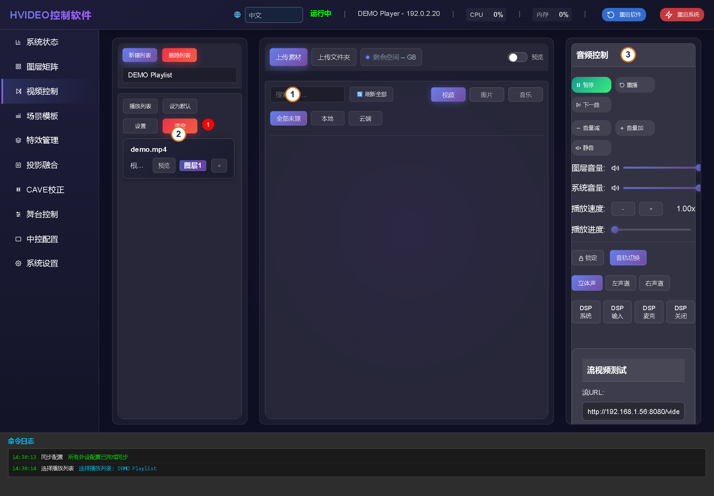

图 6 素材播放列表与播放控制

① 素材类型与来源；② 播放列表工作区；③ 音频与播放控制。

### 4.1 素材类型来源与上传

素材区按视频、图片、音乐筛选，支持本地/云端来源、搜索、文件夹浏览、刷新和拖放上传文件或文件夹；上传区显示进度，内置存储或 SATA 硬盘的剩余空间在可用时显示。

### 4.2 素材与文件夹管理

选择素材可预览视频、查看图片或播放音频；素材卡片支持加入播放列表、下载、重命名、删除。文件夹支持重命名和删除；删除文件夹会删除其中全部文件且不可恢复。默认文件夹受保护。

### 4.3 重新编码与批量优化

勾选视频后可“重新编码”或“批量优化”；已优化文件会跳过。编码期间查看进度，不要关闭页面或重复发起同一任务。

### 4.4 新建与管理播放列表

播放列表区提供新建、选择、播放、删除列表、清空内容、设为默认和设置。新建时设置名称、播放图层、循环方式及适用的 DMX 编号。图层需具备相应播放授权。

### 4.5 切换列表与播放行为

当前实现中，列表选择下拉框切换时会自动开始播放该列表；列表项本身的选择用于查看/编辑内容。“播放”按钮会重新启动当前列表。删除列表、清空内容前确认目标和弹窗提示。

### 4.6 循环方式与图片时序

列表设置可调整循环模式、DMX 编号；图片列表还可设置显示时长、淡入和淡出。可用循环方式包括循环全部、一次播放、单个循环、顺序循环和固定播放（显示项依图层类型而异）。

### 4.7 进度速度音量与播放

音频控制包括暂停/继续、重播、下一曲、音量减/加、静音；独立调整图层音量和系统音量。播放速度用减/加按钮调整，播放进度条可拖动定位。

### 4.8 播放锁定

“锁定”切换当前图层的播放锁；若全局锁定生效，页面会提示该按钮只控制当前图层锁。

### 4.9 预览开关与浮动预览

若启用视频预览开关，播放列表素材的“预览”动作还会弹出可拖动的 MJPEG 小窗，标题栏可关闭窗口；关闭预览开关也会关窗。播放预览本身会实际操作目标播放层。

### 4.10 音轨声道与 DSP 路由

音轨切换按钮切换可用音轨；声道选择立体声、左声道或右声道。DSP 路由按钮测试 DSP 系统、输入、麦克和关闭路由，属于即时硬件操作。

### 4.11 流视频测试

流视频测试：填写可由设备访问的流 URL，点击“测试播放”验证播放链路。URL 示例仅为占位地址，不代表设备上存在该媒体。

### 4.12 存储与列表项的区别

- 视频素材可选择内置存储或 SATA 硬盘，空间不足/硬盘不可写时先处理存储问题；图片和音乐使用内置存储。云端可按分类筛选，云分类不作为本地上传目录。上传文件与上传文件夹分别用于单次多文件和目录上传；也可拖放。先核对本地/云端来源和当前目录，上传完成后刷新确认文件，再加入目标图层的播放列表。
- 播放列表内容区可选择、预览和移除单项；移除列表项与删除素材文件是不同操作。清空只清当前列表内容；删除列表前核对名称。

### 4.13 从上传到默认播放的完整步骤

1. 选择视频和本地来源，确认目标目录与剩余空间。
2. 上传一个可识别的视频，刷新后预览文件。
3. 新建播放列表，选择授权视频图层并设定循环方式。
4. 将素材加入列表，播放并检查进度、音量和画面。
5. 需要时设置 DMX ID，然后设为默认列表。
6. 重新读取列表，确认内容和默认项；需要验证开机播放时在允许中断后重启检查。

## 第5章 场景模板与默认配置

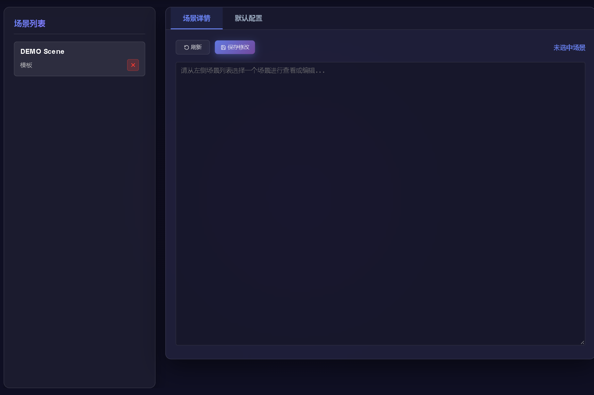

图 7 场景列表与 JSON 编辑器

### 5.1 编辑并保存场景 JSON

左侧选择场景；“刷新”重读所选场景，“保存修改”把编辑器中的 JSON 保存回该场景。修改前建议复制原始内容，提交前检查 JSON。

### 5.2 默认配置与重启边界

“默认配置”页签提供核心 `config.json` 的加载与提交。该文件影响系统行为；只修改明确了解的键，保存后按页面提示重启应用。

### 5.3 删除场景与保存前检查

场景列表的删除按钮用于删除所选场景；默认配置受保护。编辑 JSON 时保留原文件，确认对象名称和 JSON 语法，保存后重新选择同一场景确认内容。图层矩阵的另存为用于生成布局场景，本页用于查看和编辑已有内容。

## 第6章 特效与音频反应引擎

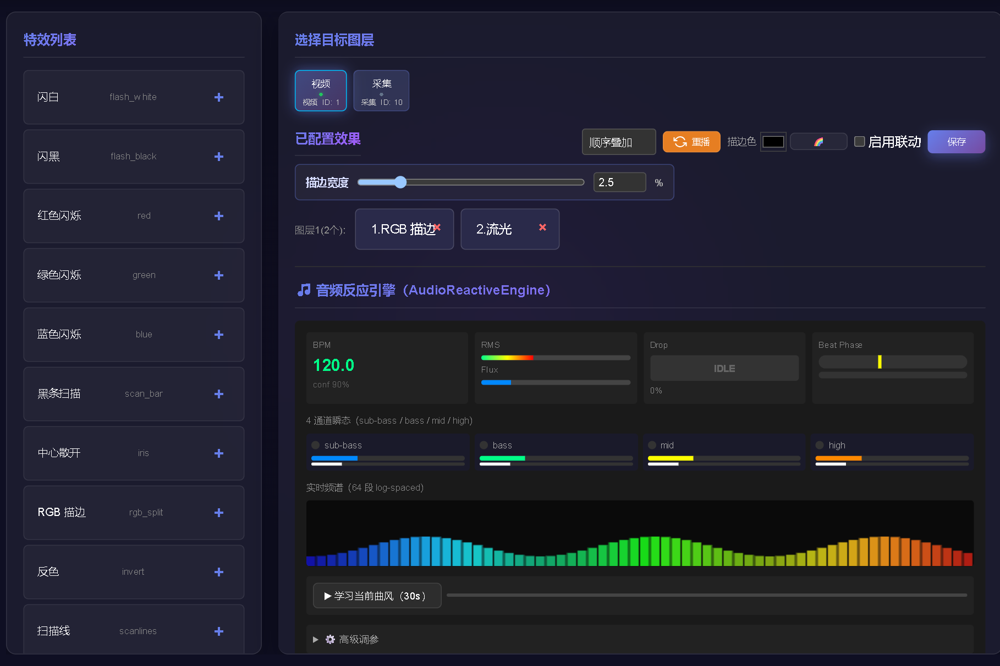

图 8 目标图层特效组合与音频分析

### 6.1 配置预览联动与保存

选择目标图层，为其配置一个或多个实时特效；预览单个特效、调整叠加顺序（顺序/并行）、描边颜色和宽度、启用联动并保存。配置是否立即作用于各图层取决于联动状态。

### 6.2 节拍学习与高级调参

音频反应引擎可显示节拍/BPM 和置信度，选择“学习当前曲风（30s）”分析当前播放内容，再次操作可停止；“高级调参”可设置频段切分、瞬态阈值、BPM 范围、Drop 判定/衰减、频谱增益和密集节拍判定参数。调参会提交到设备，建议一次修改少量参数并观察结果。

### 6.3 颜色描边与移除效果

选择目标图层后再添加特效；颜色和描边宽度作用于当前对象。彩虹按钮恢复彩虹模式，重播用于测试，已选效果上的移除按钮解除该项配置。启用联动、叠加方式和效果列表应一起保存并复查。第14章列出当前全部特效 ID。

### 6.4 音频反应全部调参项

实时指标包括 BPM 与置信度、RMS、Flux、Drop 状态及强度、Beat Phase、四频段能量与瞬态、64 段实时频谱。先播放有代表性的音频，再观察各项变化。展开高级调参后，滑块拖动时显示数值，松开产生 change 后提交设备；不依赖上方的特效保存按钮。每次修改一组参数，观察后再继续。

| 页面参数 | 范围与步长 | 操作用途 |
|---|---|---|
| cut sub/bass Hz | 20–200，步长5 | 超低频与低频分界 |
| cut bass/mid Hz | 100–800，步长10 | 低频与中频分界 |
| cut mid/high Hz | 800–6000，步长50 | 中频与高频分界 |
| 阈值 sub、bass、mid、high | 各1.1–3.0，步长0.05 | 分别调整四频段瞬态检测阈值 |
| BPM 下限与上限 | 下限40–120；上限120–240；步长1 | 约束节拍搜索范围 |
| Drop RMS 比 | 1.2–4.0，步长0.05 | Drop 判定参数 |
| Drop 衰减 | 0.2–5.0秒，步长0.1 | Drop 强度衰减时间 |
| 频谱增益 | 0.5–3.0，步长0.1 | 频谱增益参数 |
| Dense 中频× | 1.02–2.0，步长0.02 | 密集节拍检测比例参数 |
| Dense 高频× | 1.00–1.6，步长0.02 | 密集节拍检测比例参数 |
| Dense 进入占比 | 100–800，步长20 | 对应进入确认时间，单位ms |
| Dense 退出占比 | 20–500，步长20 | 对应退出确认时间，单位ms |

### 6.5 特效配置验证

选择一个目标视频层，添加并预览一个特效，设置叠加方式和联动后保存。切换图层再回到原图层检查组合；播放实际节目观察 BPM、瞬态与效果响应。移除测试效果并保存正式组合。

## 第7章 投影融合与移动端调试

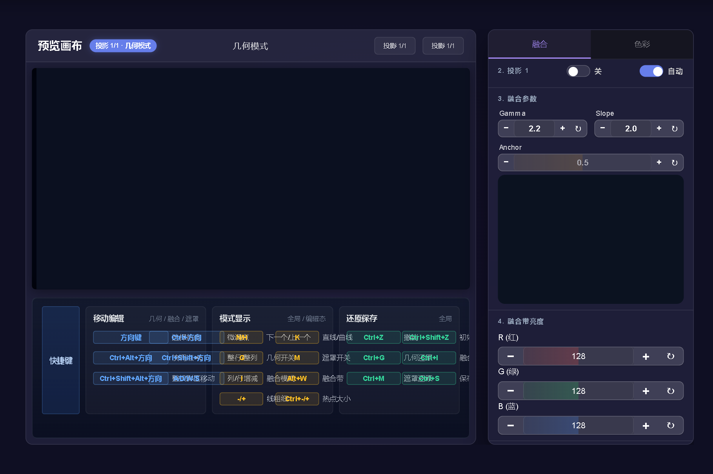

图 9 桌面融合画布与控制区

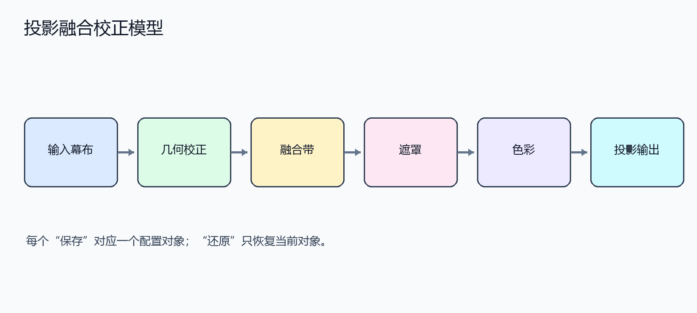

图 10 几何融合遮罩与色彩的关系

### 7.1 布局与区域选择

预览画布显示输入网格、融合区和控制点。布局预设用于选择融合布局；“投影 N/M”在各投影区域间切换。

### 7.2 融合边与自动邻接

“融合”和“色彩”两个页签用于编辑几何/融合/遮罩及区域色彩。融合区域可启用总开关、自动按输入邻接关系设置边，或手动开关上/下/左/右边。

### 7.3 融合曲线与区域色彩

融合参数 Gamma、Slope、Anchor 和 RGB 融合带亮度控制过渡曲线。色彩页调整亮度、对比度、饱和度。

### 7.4 几何网格与遮罩插值

几何编辑支持点击/拖动热点、画布网格和网格行列调整；融合/遮罩可选线性或曲线插值。遮罩控制输入画布裁切/边界。

### 7.5 调试背景与省性能

背景控制（异步加载）可切换上一张/下一张、显示/隐藏融合调试背景；“省性能”调试时暂停正在播放的视频图层。

### 7.6 打开融合移动端

可选融合移动端二维码/链接可在同一网络的手机浏览器打开 `/fusion-mobile/`。移动页提供布局、几何、融合、遮罩、色彩、高级校正，以及图层矩阵、视频控制、中控配置、系统状态等快捷面板；页面内的“保存几何/融合/遮罩/色彩”分别提交相应配置。

### 7.7 保存撤销还原与初始化

调试操作会实时影响画面；完成后使用保存按钮或 Ctrl+S 持久化融合配置。Ctrl+Z 撤销最近编辑，Ctrl+G/I/M 分别还原几何、融合、遮罩，Ctrl+Shift+Z 初始化相关校正。初始化和还原会改变配置，先确认目标区域。完整快捷键见第14章。


### 7.8 移动端各面板逐项操作

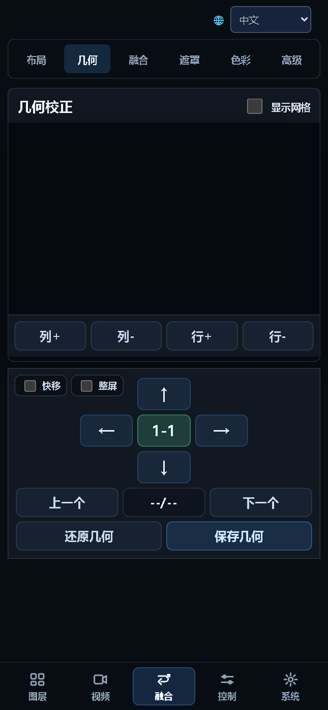

图 11 手机融合调试界面

- 布局：选择矩阵布局并点击“应用布局”，会改变投影区域组织。应用前确认现有校正是否仍适用于新布局。
- 几何：启用几何，选择区域和热点，用方向键调点；“列+/列-/行+/行-”修改网格密度；“上一个/下一个”切区域；“还原几何”和“保存几何”分别还原和提交。
- 遮罩：启用全局遮罩，选择控制点后用方向键调整；“还原遮罩”还原配置，“保存遮罩”提交。遮罩会影响最终可见画面。
- 融合：选择区域和融合带控制点，方向键调节；上一/下一区域切换；分别执行“还原融合/保存融合”。RGB、Gamma、Slope、Anchor 的减/加/复位按钮控制相应数值。
- 色彩：区域色彩提供重置与保存色彩；上一张、显示/隐藏、下一张用于调试背景。背景切换与色彩保存是独立操作。
- 高级：初始化融合；设置矩阵偏移、缩放、旋转和梯形后“应用矩阵校正”；选择墙面并设置视距、近远平面、三个角点后“应用 CAVE 配置”。“初始化 CAVE”会改动墙面几何。
- 快捷面板：图层矩阵可刷新并调整可用图层；视频控制选择列表后播放、停止、重播、静音和音量加减；中控配置按 DMX/串口/网络查看或操作；系统配置查看设备状态。各面板的刷新用于回读，具体可见字段依授权和硬件显示。

### 7.9 检查接缝并回读保存结果

先使用调试网格对齐几何，再使用均匀亮度背景检查接缝，最后检查遮罩和区域色彩。切换到下一投影区域前保存当前修改；全部完成后刷新回读，关闭调试背景并恢复播放。省性能操作暂停的视频需确认已恢复。

## 第8章 CAVE 与矩阵校正

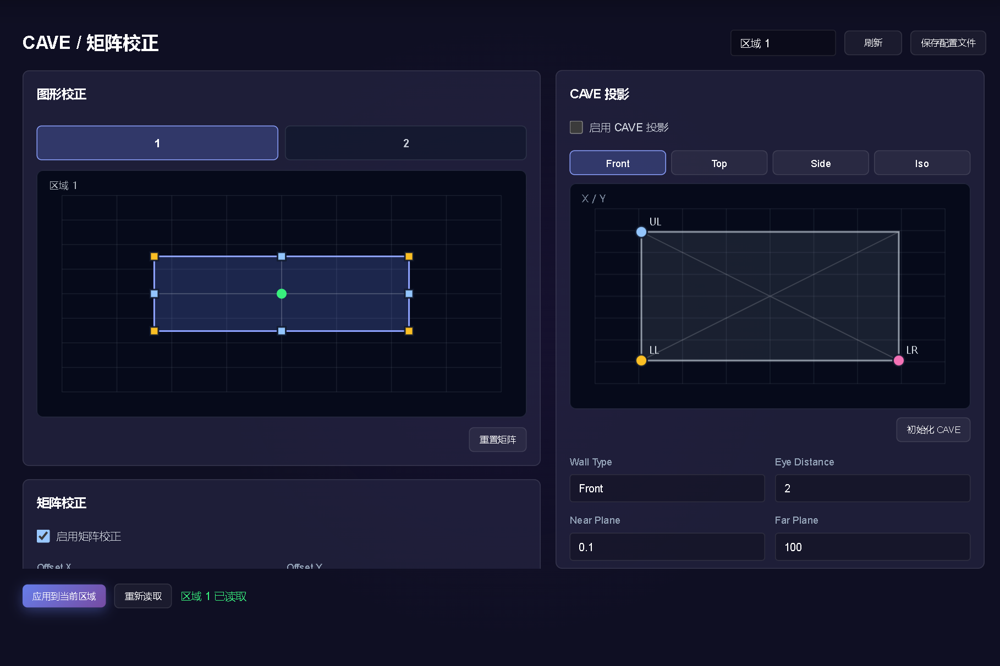

图 12 矩阵校正与 CAVE 墙面参数

### 8.1 区域选择与矩阵参数

选择目标区域并刷新读取。图形校正画布拖拽会自动保存到设备；矩阵校正包括启用、Offset X/Y、Scale X/Y、Rotate Rad、Keystone X/Y。

### 8.2 墙面视图与三个角点

CAVE 投影可启用，查看 Front/Top/Side/Iso 视图，选择墙面 Front/Left/Right/Floor/Ceiling，配置 Eye Distance、Near/Far Plane 和 LL/UL/LR 三个角点的 X/Y/Z。

### 8.3 初始化应用保存与重新读取

“初始化 CAVE”初始化墙面几何；“重置矩阵”会把校正矩阵恢复默认并立即保存；“应用到当前区域”提交当前区域设置；“重新读取”丢弃未提交输入并从设备重载。“保存配置文件”将当前校正保存至设备上的 `projection_correction.json`，不是下载到电脑的导出操作。CAVE 视图按钮只改变观察方向，选择墙面可配置对应的几何和角点坐标。

### 8.4 坐标与验证顺序

Offset 为偏移，Scale 为缩放，Rotate Rad 使用弧度，Keystone 为梯形校正。LL/UL/LR 分别表示左下、左上、右下角点；角点及视距必须使用一致的场景坐标尺度。先选择墙面，再核对视图和角点；应用后重新读取同一区域，确认图形和数值一致。

## 第9章 舞台控制与 Cue 时间轴

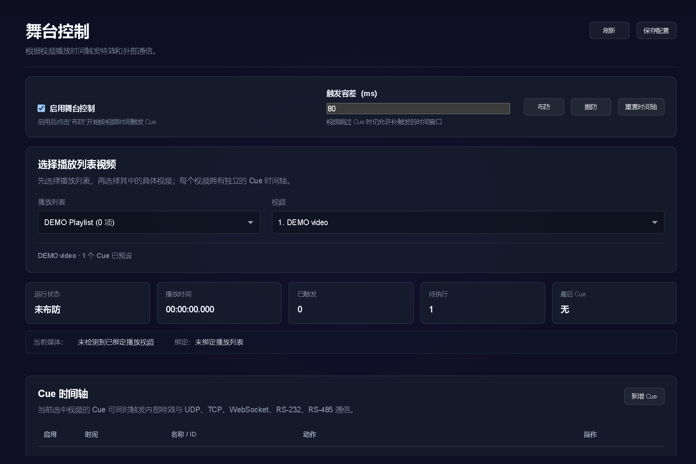

图 13 舞台控制的布防媒体选择与状态

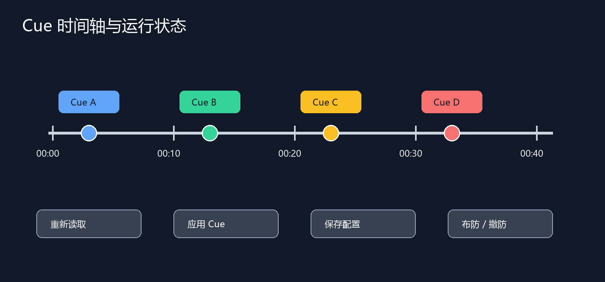

图 14 Cue 编辑与演出触发流程

### 9.1 绑定播放列表视频

选择播放列表和具体视频，为每个视频单独维护 Cue 时间轴。刷新重新读取配置，保存配置提交启用状态、触发容差及 Cue。

### 9.2 启用布防撤防与重置

启用舞台控制后点击“布防”按播放时间触发 Cue；“撤防”停止触发；“重置时间轴”重置运行进度。触发容差决定跳过 Cue 时补触发的时间窗口。

### 9.3 Cue 动作编辑预览与删除

Cue 可启用/停用，设置 ID、名称、触发时间并编辑动作 JSON；“应用 Cue”只更新页面中的当前视频配置，仍须点击“保存配置”写入设备。列表操作可编辑、预览、删除；预览会立即向设备执行该 Cue。动作支持内部特效和 UDP、TCP、WebSocket、RS-232、RS-485 通信。后端会校验动作。测试 Cue 前确认网络地址、串口、端口与接收设备，避免误触发现场设备。

### 9.4 新增应用取消与外层保存

状态区以外，Cue 编辑支持“取消”放弃当前编辑、“应用 Cue”接受编辑；“新增 Cue”创建 Cue。切换播放列表视频前先保存，以免遗失本页未保存的更改。

### 9.5 运行状态与错误信息

状态区显示绑定媒体、播放时间、布防状态、已触发/待执行数量、最近 Cue 和错误信息。

### 9.6 时间格式与动作 JSON 示例

触发时间可填 `HH:MM:SS.mmm` 或毫秒整数，例如 `00:00:05.000` 与 `5000` 都表示 5 秒。容差范围 0–2000 ms。Cue ID 在当前视频内唯一，长度 1–128，仅可含字母、数字、点、下划线和短横线。动作编辑器填写非空 JSON 数组；下面示例为图层 1 的 ID 8 特效，不含外设发送。

```json
[
  {"kind":"effect", "layer_id":1, "effect_no":8, "effect_params":{}}
]
```

将示例填入动作编辑器 → 应用 Cue → 保存配置 → 先单条预览 → 布防后播放对应视频。更换列表项媒体后应重新核对绑定与 Cue。

## 第10章 中控配置与外设通信

### 10.1 DMX512 接收与模拟

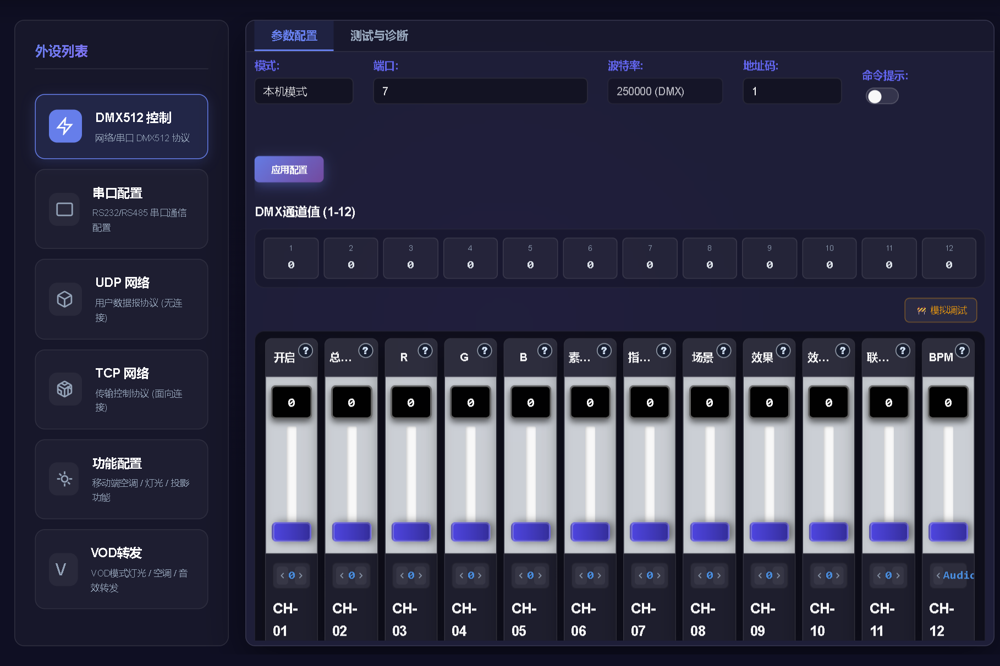

图 15 DMX512 接收与模拟

DMX512：选择本机/外接模式、端口和波特率，设置起始地址；通道 1–12 可按控件调值，实时数据/手动模式切换可用工作方式；“应用配置”提交。检查地址范围和 DMX 接线。

### 10.2 串口与墙板模板

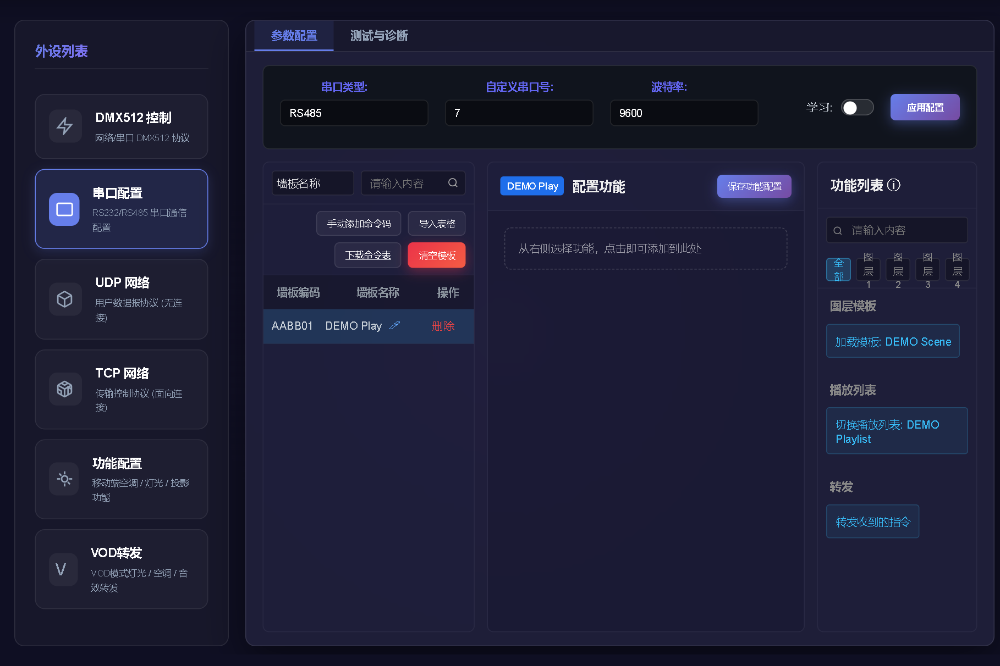

图 16 串口与墙板模板

RS232/RS485：选择串口类型、端口/设备路径和波特率；“学习模式”按页面提示从串口学习墙板命令，须先填写有效串口号或设备路径，启用时页面会刷新学习结果；添加、导入、搜索、选择、重命名或删除墙板命令模板。Excel/CSV 导入首行须包含唯一“墙板编码”和“墙板名称”，每次 1–1000 条，文件不超过 2 MB。清空模板会删除该串口类型全部模板。

### 10.3 模板功能绑定

模板功能：从功能列表按全部/图层 1–4 筛选功能，将功能绑定到所选命令并保存。图层筛选只改变列表显示。

### 10.4 多协议转发与命令映射

模板转发与固定发送：收到串口命令后可创建转发目标，目标包括 RS232、RS485、UDP、TCP、WebSocket；按目标填写串口、地址/端口或组播地址，选择定向/广播、UDP 广播/组播、发送固定 Hex/文本或命令映射。可在多个目标之间转发。命令映射未匹配时默认继续转发原始指令；同一输入可对应多条按顺序发送的映射。配置弹窗确认后仍需保存所属模板功能。

### 10.5 UDP 监听与触发模板

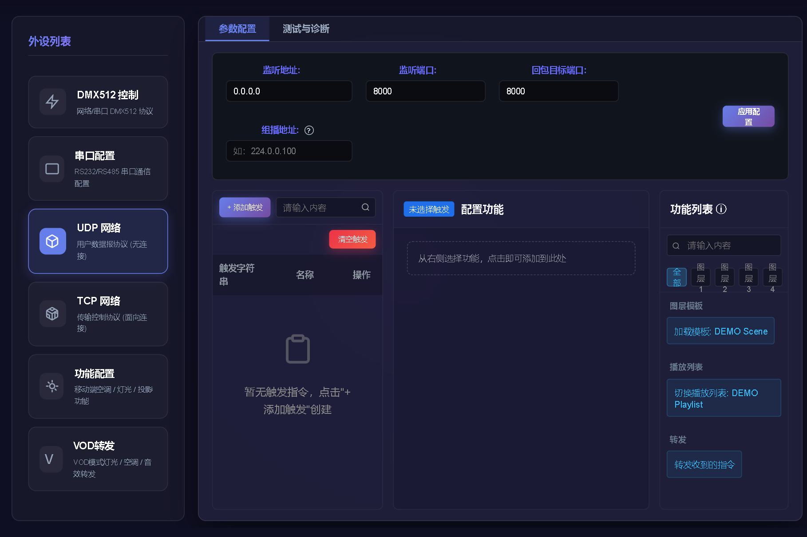

图 17 UDP 监听与触发模板

UDP：设置监听地址/端口、回包目标端口和可选组播地址；添加、搜索、重命名/删除触发字符串，配置命中触发执行的功能并保存。清空触发会删除该协议全部触发模板。

### 10.6 TCP 模式与触发模板

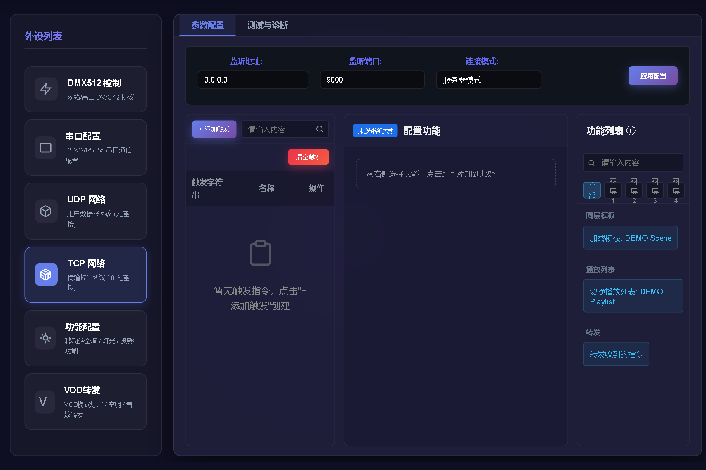

图 18 TCP 模式与触发模板

TCP：设置监听地址/端口和服务器/客户端模式；触发字符串及功能绑定与 UDP 类似。保存网络配置后检查客户端/服务器目标参数（如页面出现）和防火墙。

### 10.7 移动端功能配置

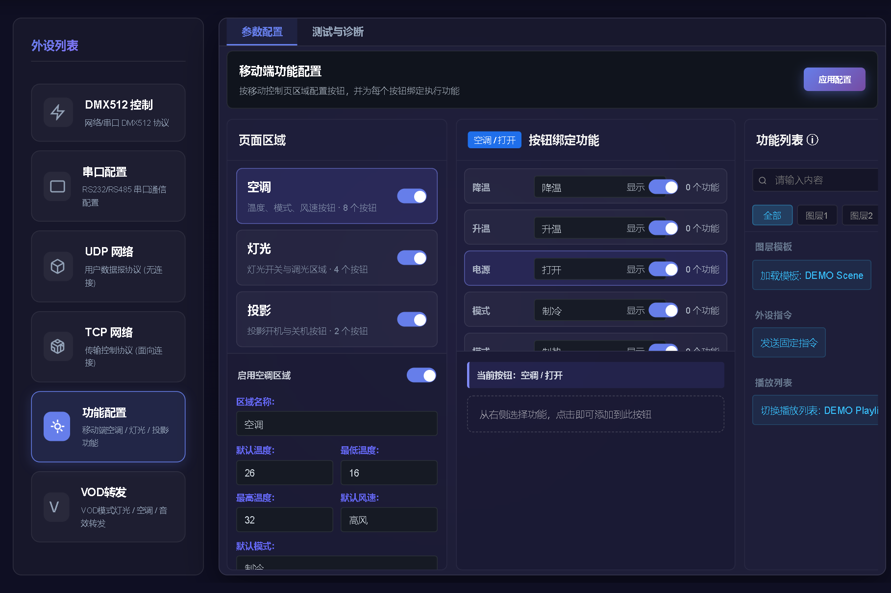

图 19 移动端功能配置

移动端功能配置：选页面区域和按钮，从功能列表绑定动作并应用配置；按钮可执行灯光、空调、投影或图层功能，具体项目依授权/设备而定。

### 10.8 VOD 事件转发

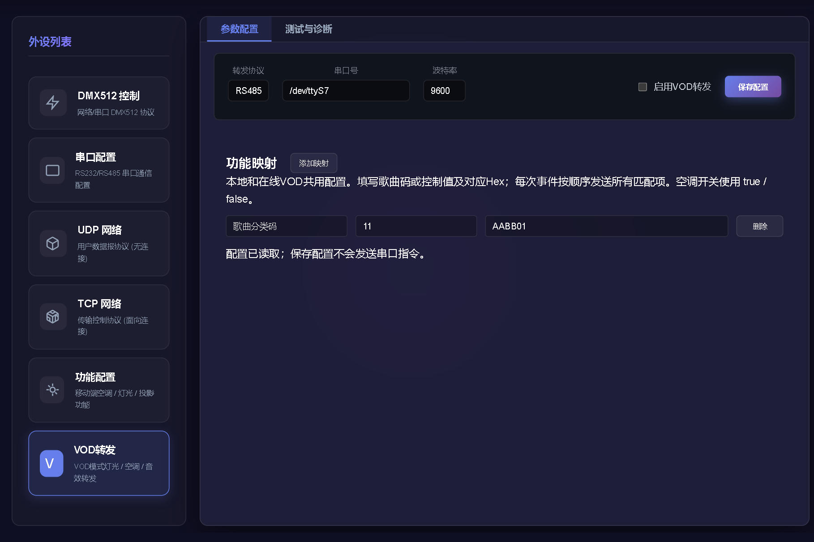

图 20 VOD 事件转发

VOD 转发仅在本地或在线 VOD 模式启用时显示。启用或关闭转发，选择 RS485/RS232、端口/串口号和波特率；添加歌曲/控制事件映射和发送 Hex。按顺序发送所有匹配项；空调开关字段使用 `true`/`false`。

### 10.9 测试发送与交互日志

测试与诊断：选择当前调试协议/设备，输入完整 Hex 指令并发送；交互日志显示结果，“清空”只清日志。测试指令会实际发送到外设，先确认对象与接线。

### 10.10 导入表格与学习验证

1. 先保存 RS232 或 RS485 的串口参数。
2. 手动添加命令，或开启学习模式后操作真实墙板。
3. 批量导入时使用 Excel/CSV，列名必须含唯一“墙板编码”和“墙板名称”；每次 1–1000 条，文件不超过 2 MB。
4. 导入后搜索目标模板，核对编码与名称。
5. 添加功能并保存；使用墙板实测，检查接收、匹配和执行日志。
6. 完成学习后关闭学习模式，避免继续录入现场杂讯。

### 10.11 保存层级与移动端按钮细节

1. 先保存协议基础配置，如串口号/波特率或网络监听地址/端口。
2. 选择墙板命令或 UDP/TCP 触发模板，按需从功能列表加入一个或多个功能；移除不需要的绑定。转发功能需要另行填写目标协议及发送参数。
3. 点击对应“保存功能配置”；弹窗内的确定只确认弹窗，不能代替所属模板的保存。
4. 通过测试与诊断或真实墙板触发，查看交互日志和命令日志，确认接收命令、匹配模板和发送目标符合预期。

移动端功能配置还可启用/禁用空调、灯光和投影区域，改标题及按钮文字，设置空调默认温度/最小最大温度/默认模式/风速，灯光调光启用和默认亮度、各灯默认开关，以及投影开/关动作。选择按钮、绑定功能后点击“应用配置”，再到实际移动端核对显示和控制结果。

### 10.12 转发配置的验证步骤

为已选模板添加转发目标，先核对协议、地址/串口、端口/波特率。选择固定内容或命令映射，弹窗确认后保存模板功能。用一条明确的输入命令触发，并在接收端核对实际字节。测试未匹配映射时的原始命令透传行为；多目标或多映射要检查顺序及重复发送。

## 第11章 系统设置与维护

### 11.1 授权信息与导入

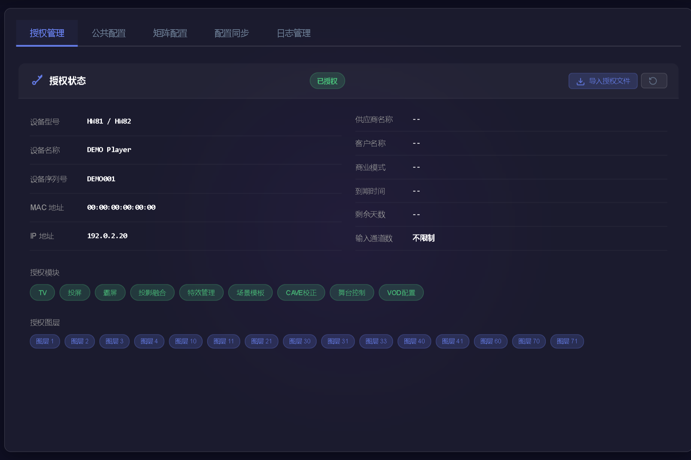

图 21 授权信息与导入

授权管理：查看授权状态、设备型号/名称/序列号/MAC/IP/指纹、供应商/客户、商业模式、到期与授权模块，导入授权文件。仅导入与该设备匹配且可信的授权文件。

### 11.2 公共配置总览

公共配置分为定时、网络、同步播放、VOD、显示和选项；歌词与字幕位于 VOD 分类内。逐项说明见 11.10–11.16。修改后点击“保存配置”。

启动无线模式需重启设备；渲染质量和歌词字体需重启应用；分辨率切换可能短暂黑屏。其余字段按页面提示生效。

### 11.3 矩阵输入输出与重置

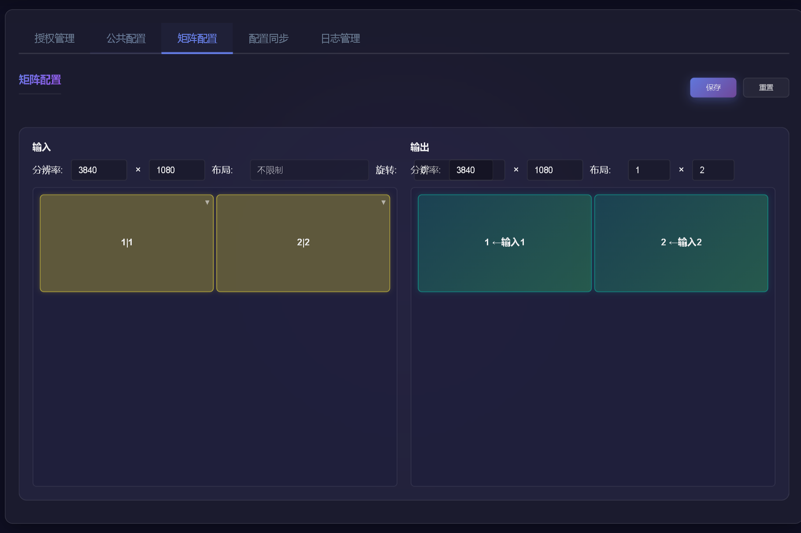

图 22 矩阵输入输出与重置

矩阵配置：查看/编辑输入、输出分辨率、行列布局和画布旋转；输入/输出信号源区域按设备配置显示。“保存”会应用并持久化新矩阵，可能改变投影/播放区域；“重置”是从已保存配置重新加载，不是恢复出厂默认。先确认当前播放分布与许可通道数。

点击输入区域单元格打开下拉菜单，可选择“输出到屏幕N”或“禁用输出”。右侧输出格显示来源输入；检查所有区域映射后点击“保存”。输入布局按授权通道限制，修改分辨率、布局或旋转后应重新检查每个映射。

### 11.4 显示输出与系统分辨率

显示配置内的“显示输出”在 HDMI/MIPI 间保存选择；若提示“待重启”，使用“重启”使输出选择生效。系统分辨率在支持时选择后须确认，系统画面可能短暂黑屏；读取失败时可重试。

### 11.5 授权服务地址

可显示“授权服务地址”编辑及保存入口；修改前确认服务端提供的正确地址。

### 11.6 局域网同步与完整备份还原

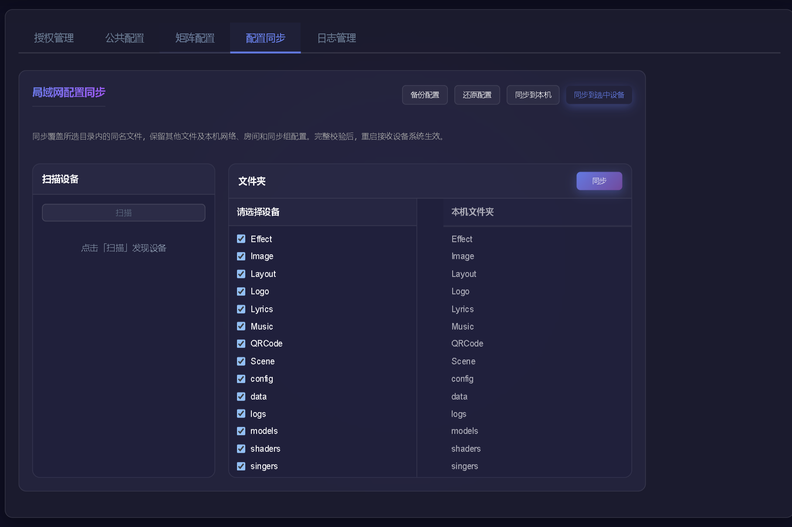

图 23 局域网同步与完整备份还原

配置同步：选择“拉取到本机”或“推送到设备”，扫描局域网设备、勾选源/目标设备及一个或多个文件夹，再执行同步。同步只处理选中的目录，同名文件会覆盖，目标设备的网络、房间和同步组配置会保留；接收端完整校验后必须重启系统。独立“备份配置/还原配置”以 ZIP 导出或上传完整配置：备份会下载名为 `hsvj-config-时间戳.zip` 的文件；还原只接受非空 ZIP（最大 8 GB），校验后设备会自动重启。若完整还原已校验但重启请求未确认，再次点击还原配置可重试重启；重启完成前不要重复上传。完整还原会替换参与还原的当前配置目录，备份中没有的旧文件也可能移除；视频目录不参与，设备授权和 ROM 升级/下载目录保留，不靠此备份迁移。完整还原与局域网同步的保留规则不同，完整还原前务必保存设备当前状态并确认备份来源。

### 11.7 日志浏览搜索下载与删除

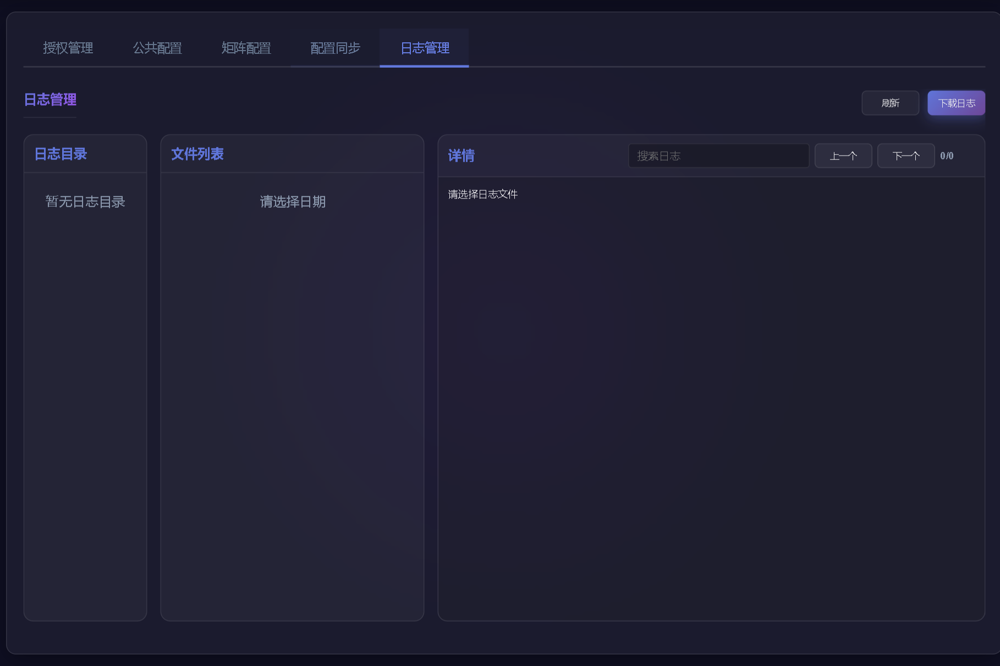

图 24 日志浏览搜索下载与删除

日志管理：需输入日志管理密码。按日期和文件浏览日志，打开详情、下载、删除日期/文件；详情支持搜索关键词、上一个/下一个匹配项。删除为永久操作；分享日志前检查是否包含网络或设备信息。

### 11.8 工厂序列号维护页

工厂序列号独立页（若由设备部署方提供入口）：显示当前/待生效序列号；输入以字母开头、总长 1–14 位的字母数字序列号后点击“写号并重启”。页面会回读校验并在成功后 2 秒安排设备重启。结果未确认时先重新读取，切勿重复写号。

### 11.9 隐藏维护入口

开机动画隐藏操作：在“设备信息”的设备名称上 2 秒内连续点击 10 次可修改设备名称；供应商名称 2 秒内连续点击 10 次可打开开机动画选择。隐藏入口并非普通菜单项；切换动画前核对选项。

### 11.10 定时开关机

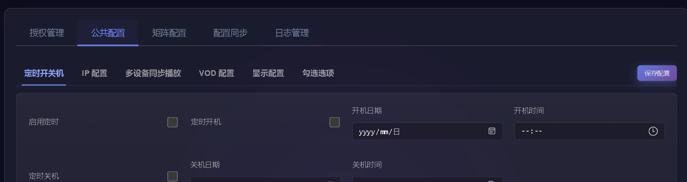

图 25 定时开关机

定时：总开关决定定时开关机是否启用；分别填写开机/关机日期和时间。先核对设备时钟与现场计划再保存。

### 11.11 IP 无线与 USB OTG

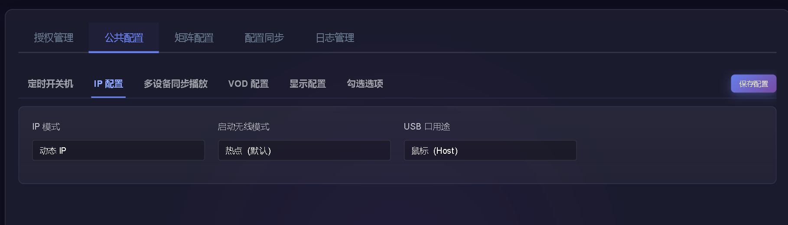

图 26 IP 无线与 USB OTG

网络：动态 IP 自动获取；固定 IP 需同时核对 IP、网关和 DNS。改 IP 后从新地址连接。启动无线模式决定下次启动进入热点或 Wi-Fi；USB Host 用于主机外设，Peripheral 用于设备模式，Auto 按支持情况自动选择。

### 11.12 多设备同步播放

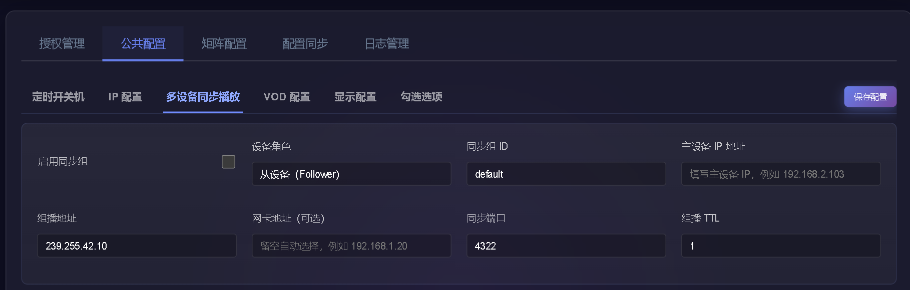

图 27 多设备同步播放

同步组：启用后选择主/从、组 ID；从设备填写正确的主机 IP，组播地址、端口、网卡地址和 TTL 应与组内网络规划一致。此功能是多设备运行同步，与文件夹配置同步不同。

### 11.13 VOD 来源房间与音频

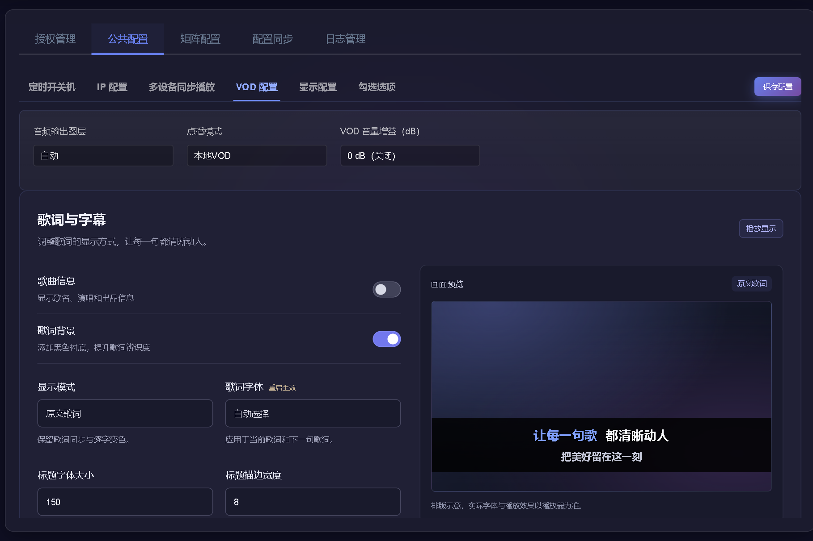

图 28 VOD 来源房间与音频

VOD：音频输出图层决定点播音频目标；本地/在线模式决定点播来源。在线模式填写服务器 Host 和房间 ID；增益以 dB 调节。修改后用实际点歌确认音频、歌词和目标图层。

### 11.14 显示帧率与渲染质量

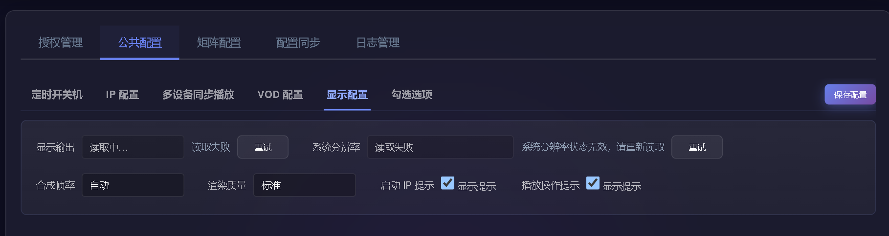

图 29 显示帧率与渲染质量

显示：显示输出选择 HDMI/MIPI；系统分辨率决定系统输出模式，合成帧率和渲染质量影响显示性能。选择受硬件支持范围限制，按提示确认、保存或重启。

### 11.15 启动与更新选项

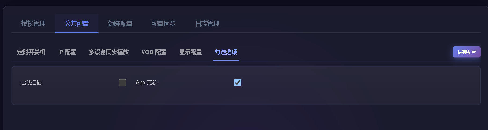

图 30 启动与更新选项

选项：启动 IP 提示控制启动网络提示；播放操作提示控制播放时提示；启动扫描控制本地歌曲启动扫描；App 更新开关控制相应更新选项。

### 11.16 歌词字幕与字体

歌词字幕：分别设置歌词与字幕、歌曲信息、歌词背景、原文/拼音显示模式和字体；标题字号/描边、歌词字号/描边/字间距分别调节对应文本，“出品文字”设置歌曲信息中的出品内容。查看页面预览后保存，字体修改需重启生效。

### 11.17 完整还原与同步的区别

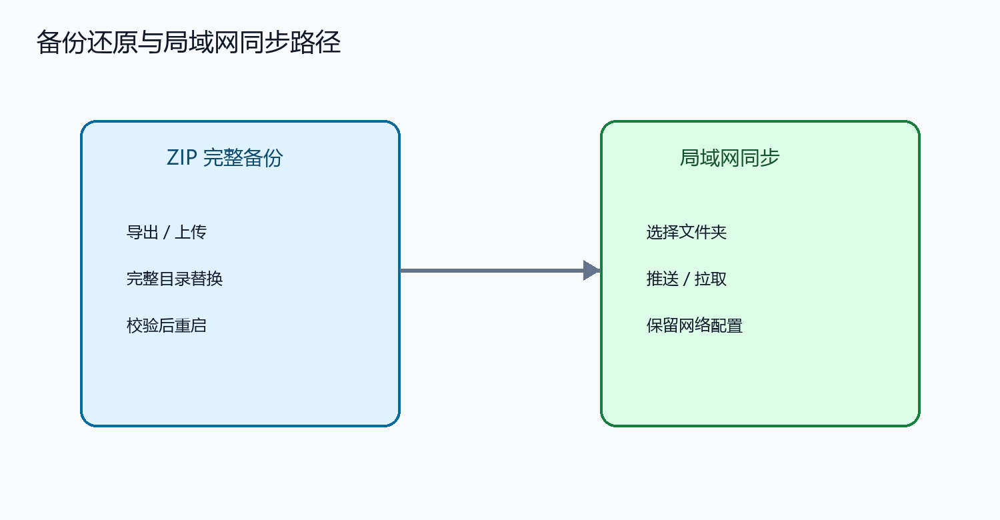

图 31 备份同步与重启边界

| 操作 | 处理范围 | 完成条件 |
|---|---|---|
| 运行同步组 | 多设备播放协同 | 主从和组参数一致，实际播放验证 |
| 局域网配置同步 | 选中目录，同名覆盖 | 接收端校验并重启，保留网络房间和同步组 |
| 完整 ZIP 还原 | 参与还原的配置目录替换 | 校验后重启；视频不参与，授权和 ROM 目录保留 |

## 第12章 故障排查

### 12.1 常见现象与处理顺序

- 无法连接：确认浏览器访问设备的 `http://IP:8080/`、电脑与播放器网络互通，刷新后重试。
- 模块或图层缺失：检查授权状态和设备型号；未授权模块或不可用图层会隐藏或只读。
- 参数不一致：使用模块“刷新/重新读取”回读服务端状态，确认保存成功后再继续操作。
- 音画/投屏问题：先查看“系统状态”和命令日志，再检查视频图层输入、采集卡信号、投屏连接与系统音频路由。
- 设备可能已执行但浏览器超时：等待设备恢复后刷新对应模块，不要连续重复重启、还原、删除或外设发送操作。

### 12.2 专项故障定位

| 现象 | 优先检查 | 恢复验证 |
|---|---|---|
| 画面空白或错位 | 可见性、透明度、图层位置、矩阵和输入信号 | 用单图层测试素材确认 |
| 上传失败 | 来源、存储路径、剩余空间和写权限 | 刷新确认文件后再加入列表 |
| DMX 不响应 | 模式、接线、起始地址、CH01 和模拟状态 | 清空模拟后检查实时通道 |
| 墙板命中但无动作 | 当前串口模板、已绑定功能、外层保存 | 发送一条命令并比对日志 |
| Cue 不触发 | 启用、布防、绑定媒体、时间和容差 | 先预览，再播放对应视频 |
| 接缝或遮罩异常 | 当前区域、几何、融合边、遮罩和背景 | 分项还原前先保留配置 |
| 音频无声 | 图层/系统音量、静音、声道、音轨和 DSP | 用已知音频逐级检查 |
| 改 IP 后失联 | 新 IP、网关和控制电脑网段 | 从新地址登录并回读 |
| 还原后待重启 | 校验状态和重启请求结果 | 完成重启，避免重复上传 ZIP |

### 12.3 提交给维护人员的信息

记录设备型号、序列号、IP、软件版本、操作时间、页面名称、复现步骤、预期/实际结果和相关日志。画面问题附当前布局及目标区域截图，外设问题附协议参数与完整发送/接收内容。

## 第13章 现场操作案例

### 13.1 首次部署全过程

1. 在系统状态核对设备，再到授权管理确认模块和图层授权。
2. 在公共配置设置网络、VOD 和显示输出；保存后按提示重启并重新连接。
3. 在矩阵配置设定输入画布和输出布局，再到图层矩阵创建需要的图层、调整位置和大小、保存场景。
4. 上传素材，创建播放列表并添加素材；播放确认后按需要设为默认列表。
5. 依现场需求调几何、融合、遮罩和色彩，保存对应配置；CAVE 校正另外核对目标区域。
6. 最后配置中控触发、转发和 Cue，逐条测试接收设备；完成后下载配置备份和故障排查所需日志。

### 13.2 双区域投影的调试顺序

1. 核对授权输入通道和现场输出尺寸，在矩阵配置建立两区域布局并保存。
2. 在图层矩阵安排视频或采集层，保存场景，播放测试素材。
3. 进入融合，依次选择区域，先几何对齐，再调整重叠边和过渡曲线。
4. 检查遮罩、亮度、对比度和饱和度，保存融合。
5. 若需 CAVE，单独选择墙面和区域，应用并保存配置文件。
6. 关闭调试背景、恢复视频，刷新回读并重启复查；最后备份。

### 13.3 墙板触发与视频 Cue 联合验证

1. 保存串口参数，学习或导入墙板模板。
2. 给模板绑定目标功能，保存模板功能。
3. 给目标列表视频新增 5 秒 Cue，应用 Cue 并保存配置。
4. 先单条预览，确认动作正确，再布防。
5. 使用墙板启动目标播放，检查串口日志、播放进度和 Cue 已触发计数。
6. 撤防后检查时间轴不再触发，恢复正式运行所需状态并备份。

## 第14章 参数与快捷键参考

### 14.1 保存生效与重启速查

页面“刷新/重新读取”用于回读设备，不负责保存输入。“保存/应用”依模块执行；Cue 编辑与模板弹窗可能还需要外层保存。图层拖动、CAVE 拖动、播放、预览、发送指令等会直接影响设备。配置文件和局域网同步接收端的“待重启”表示数据已校验但尚未完成应用；应完成重启后再检查。没有收到成功提示时先回读实际状态。

| 对象 | 提交方式 | 验证方式 |
|---|---|---|
| 图层和场景 | 属性保存、保存或另存为 | 重新选择场景和图层 |
| 融合 | 保存或 Ctrl+S | 刷新当前区域 |
| CAVE | 应用区域、保存配置文件 | 重新读取 |
| Cue | 应用 Cue 后保存配置 | 刷新后查看绑定和 Cue |
| 中控模板 | 弹窗确定后保存功能配置 | 真实触发和日志 |
| 公共配置 | 保存配置，按提示重启 | 回读并检查现场输出 |

### 14.2 融合快捷键完整清单

桌面融合键盘快捷键：方向键选热点；Ctrl+方向键微调点（2 像素）；Ctrl+Alt+方向键快速移动（5 像素，也可用 Ctrl+Alt+W/A/S/D）；Shift+方向键或 Ctrl+Shift+方向键移动整行/列；Alt+Shift+方向键移动融合管理边线；Ctrl+Shift+Alt+方向键移动整投影区；A/D 增/减列、W/S 增/减行；N/H 下一个/上一个区域；K 切换直线/曲线；G 几何开关；M 遮罩开关；I 融合模式；Alt+W 融合带开关；-/+ 调网格线粗细；Ctrl+-/+ 调热点大小；Ctrl+Z 撤销；Ctrl+Shift+Z 初始化几何/遮罩/融合；Ctrl+G、Ctrl+I、Ctrl+M 分别还原几何、融合、遮罩；Ctrl+S 保存；P 显示移动步长。快捷键在融合画布获得焦点时使用。初始化和还原会改动校正配置。

### 14.3 DMX 十二通道映射

各通道卡片的“?”显示当前版本数值说明；滑块和减/加按钮改变值，模拟调试锁定当前值，清空模拟后回到实时接收。以下编号相对配置的起始地址。

- CH01 开启：0 关闭 DMX 控制并还原运行状态，1-255 开启。
- CH02 总控亮度：0 黑屏，1-255 从暗到亮。
- CH03 红、CH04 绿、CH05 蓝：0 关闭对应颜色，1-255 增强；三通道全为 0 时关闭素材颜色叠加。
- CH06 素材目录：0 不切换；1-10 对应 DMX ID 10 的播放列表，11-20 对应 ID 20，以此类推，每 10 为一档。先在播放列表设置正确的 DMX ID。
- CH07 指定素材：0 默认第一个；1-5 第一个、6-10 第二个、11-15 第三个，以此类推，每 5 为一档。
- CH08 场景：0 保持；1-5 第一个场景、6-10 第二个，以此类推。
- CH09 效果：0 关闭效果，按当前有效效果顺序每 5 一档；未分配档位不改变效果。效果 ID 与 DMX 档位值不是同一个编号，请用“?”查当前对应关系。
- CH10 效果颜色：0 默认/七彩；1-5 红、6-10 绿、11-15 蓝、16-20 白、21-255 七彩。仅响应颜色的特效生效，固定黑底视频遮罩不变色。
- CH11 联动切换：0 只控制 CH06 列表绑定图层；1-50 联动图层 2、60-100 图层 3、110-150 图层 4、160-255 图层 1-4；未列出的间隙不要用于选择。
- CH12 BPM：0 使用音频检测；5/10/15/20/25/30/35/40/45 分别对应 95/115/118/126/128/132/140/150/155 BPM。优先使用页面提供的档位值。

### 14.4 当前特效 ID 完整清单

以下数字是特效 ID，不能直接当作 DMX 通道值。每种效果均通过选择目标图层、添加/预览、启用联动和保存操作使用；移除可退出该效果。

- 1 闪白、2 闪黑：节拍明暗闪烁；3 红色闪烁、4 绿色闪烁、5 蓝色闪烁：对应颜色脉冲。
- 6 黑条扫描：重鼓点触发从左至右扫描；7 中心散开：击鼓时收缩成中心小圈；8 RGB 描边：颜色通道分离；9 反色：颜色取反；10 扫描线：电视横条纹。
- 12 流光：单段沿边缘流动；13 帘幕对开：从中心向两侧揭开画面；14 缩放：缩放呼吸；15 旋转：持续转动；16 色彩扫光：横向光带；17 自动分屏：随音频强度切换 4/6/9/12 分屏。
- 18 圆形、19 三角形、20 圆角矩形、21 星形、22 六边形、23 菱形、24 心形、25 花瓣：暂时将目标图层裁成对应形状。
- 26 LOGO 演艺：开场徽标光阵；27 感情：红色爱心环绕；28 灵魂出窍：放大残影；29 抖动：RGB 错位抖动；31 毛刺：横向错位和色散；32 幻觉：彩色拖影；33 立方体：视频贴图立方体旋转。
- 34 边缘跑马：多段边缘光条；35 卡点残影：多层定格和彩色回声；36 霓虹描边：边缘发光、随节拍增强；37 液态玻璃：音频控制折射扭曲；38 万花筒镜像：多片镜像转动；39 卡点形状分割：鼓点触发不同分割图案；40 形状拼接：黑底上的圆形视频窗口随节拍拉伸成圆角长条。

### 14.5 参数单位与输入限制

| 参数 | 单位或限制 |
|---|---|
| 图层位置与尺寸 | 像素 |
| 图层透明度 | 0–255 |
| 图层旋转与矩阵旋转 | 图层使用度；Rotate Rad 使用弧度 |
| 裁剪 | 四边百分比 0–100 |
| EDID 宽高刷新率 | 宽 320–4088 且为8的倍数；高 240–2160；24–60 Hz 整数 |
| Cue 时间与容差 | 毫秒或 HH:MM:SS.mmm；容差 0–2000 ms |
| 串口模板导入 | 1–1000 条；不超过 2 MB |
| 完整 ZIP 还原 | 非空 ZIP；不超过 8 GB |
| 工厂序列号 | 字母开头，字母数字共 1–14 位 |

## 第15章 功能覆盖与交付检查

### 15.1 功能覆盖索引

| 功能范围 | 查阅位置 |
|---|---|
| 登录、语言、导航、重启 | 第1章 |
| 状态、资源、播放状态、命令日志 | 第2章 |
| 图层、切片、裁剪、采集、EDID、投屏、文本、二维码 | 第3章 |
| 素材、云端、SATA、优化、列表、音频、DSP、流测试 | 第4章 |
| 场景 JSON、默认配置、删除 | 第5章 |
| 特效、颜色描边、音频分析与学习 | 第6章及14.4 |
| 融合、几何、遮罩、色彩、移动端 | 第7章及14.2 |
| CAVE、矩阵校正、墙面、保存文件 | 第8章 |
| Cue 编辑、预览、布防、撤防、时间轴 | 第9章 |
| DMX、串口、UDP、TCP、转发、移动端功能、VOD、诊断 | 第10章及14.3 |
| 授权、定时、网络、同步组、显示、VOD、歌词、矩阵 | 第11章 |
| 配置同步、ZIP 备份还原、日志、序列号、隐藏维护 | 第11章 |
| 排障、部署、保存边界、参数范围 | 第12至14章 |

### 15.2 交付验收表

| 检查项 | 通过条件 | 证据 |
|---|---|---|
| 登录与授权 | 页面可访问，模块入口与授权一致 | 授权管理截图/设备序列号 |
| 矩阵与图层 | 输入输出布局、图层位置和场景已保存 | 刷新回读结果 |
| 播放 | 视频/图片/音频可播放，列表可重启复现 | 播放列表名称、日志 |
| 外设 | 触发、发送、接收日志一致 | 命令日志/交互日志 |
| 融合/CAVE | 各区域保存后画面连续，重启后仍一致 | 几何/矩阵回读 |
| 备份 | ZIP 可下载或同步完成，接收端已重启 | 文件名和重启结果 |

支持人员需要：设备 IP、型号、序列号、软件版本、复现步骤、相关时间段日志和最后一次成功配置。

说明依据当前工程实现，页面名称、字段和授权模块可能随版本变化。

### 15.3 留存资料

交付时留存设备清单、网络参数、默认场景和播放列表名称、中控模板、Cue 测试结果、融合/CAVE 回读结果、备份 ZIP 名称和操作日志。记录最近一次重启后的验证时间，便于后续维护定位。
